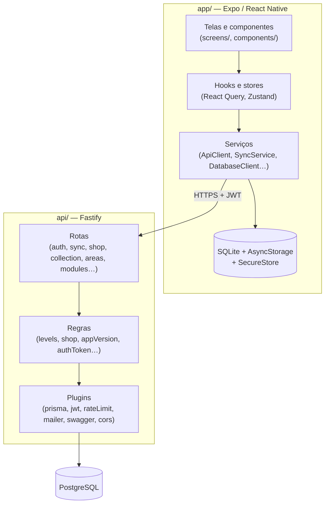

# Arquitetura

Este documento descreve as decisões estruturais do Codap e **por que** elas foram
tomadas. Os detalhes de cada fluxo estão em [fluxos/](fluxos/).

## Monorepo

```
Codap/
├── app/            # aplicativo (Expo / React Native)
├── api/            # servidor (Fastify + Prisma)
├── dashboard/      # editor local de conteúdo (Vite + React)
├── docs/           # esta documentação
├── pnpm-workspace.yaml
└── package.json    # scripts de conveniência (api:*, app:*, dash:*)
```

- **Um workspace pnpm, um `pnpm-lock.yaml`, um `node_modules`** na raiz. Instale
  sempre da raiz.
- Os scripts da raiz usam `pnpm --filter <pacote>`: `codap` (app), `codap-api`,
  `codap-dashboard`.
- `pnpm-workspace.yaml` define `publicHoistPattern` para `*expo*`, `*react-native*`,
  `@react-native/*` e `metro*`. É necessário: o `@expo/cli` usa o `metro-runtime`
  sem declará-lo, e em pnpm estrito isso quebra `expo start`.

### Contratos compartilhados

`api/src/types/contracts.ts` é a **fonte única dos tipos de request/response**.
O app e o dashboard o consomem como dependência de workspace (`codap-api: workspace:*`)
com `import type` — o import é apagado no build, então não custa nada no bundle.

- Tipos de entidades persistidas são **derivados do Prisma Client gerado**, não
  reescritos à mão.
- Como o app importa a API *só como tipo*, **não existe código executável
  compartilhado**. Duas regras são, por isso, **duplicadas de propósito** e
  precisam ser mantidas em par:
  - a **curva de nível** (`api/src/utils/levels.ts` ↔ `app/src/utils/levels.ts`);
  - os **ids das conquistas** (`api/prisma/seed.ts` ↔ `ACHIEVEMENT_IDS` no app).

## Visão em camadas



## Princípios

### 1. Offline-first no aprendizado, online onde há dinheiro

O app deve ser totalmente utilizável sem rede para **estudar**:

- o catálogo é guardado em cache persistente (`gcTime`/`staleTime` infinitos);
- a conclusão de uma lição grava, **na mesma transação** do SQLite, o progresso, o
  XP e um evento na fila de sync — progresso e pendência nunca divergem;
- o nível e os Bits locais são uma **estimativa imediata**; o servidor é a
  autoridade e o app adota o valor dele quando a fila esvazia.

Já **gastar Bits exige internet**, de propósito: um saldo gasto offline obrigaria a
desfazer compras quando o servidor discordasse. Toda compra é validada no servidor,
numa transação com a linha do usuário travada. Ver [Loja e baú](fluxos/loja-e-bau.md).

### 2. O servidor é a autoridade; o aparelho é uma estimativa

| O que | Quem decide |
|---|---|
| XP e Bits | Servidor (o app estima e se corrige) |
| Saldo, compras, dicas, baú | Servidor, sempre |
| Qual conquista foi desbloqueada | App (offline), enviada por id; o servidor só registra |
| Se o e-mail está confirmado | Servidor (o app nunca grava isso) |
| Qual conteúdo existe | Servidor |

### 3. Todo dado que vai à nuvem precisa de um caminho de volta

O progresso foi, por um tempo, enviado e nunca lido de volta — quem trocava de
aparelho ficava com XP certo e nenhuma lição marcada. Hoje `POST /sync` (ida) tem
`GET /sync/progress` (volta). **Ao criar um novo tipo de dado sincronizável, crie
também a leitura dele no login.** Ver [Sincronização e progresso](fluxos/sincronizacao-e-progresso.md).

### 4. A API transporta o conteúdo sem interpretá-lo

`activity_translations.content` é um JSONB sem forma, e `activities.type` é uma
string livre (sem enum no banco). A API **não valida** o `content`: transporta
fielmente. Quem valida é o **dashboard** (schemas zod) e quem decide o que sabe
renderizar é o **app** (um tipo desconhecido é descartado, não rejeitado).

Consequência: um tipo de atividade novo não exige migration nem mudança de schema
na API — só o componente no app, o contrato em `contracts.ts` e o formulário no
dashboard. Um app antigo simplesmente mostra a lição com uma atividade a menos.

> Por isso o schema de resposta de `GET /modules` usa `additionalProperties: true`
> no `content` e **nunca `oneOf`**. O serializador do Fastify (`fast-json-stringify`)
> apaga propriedades não declaradas e lança erro quando nenhuma variante de um
> `oneOf` casa — o que derrubaria o catálogo inteiro com 500.

### 5. Mudar conteúdo não exige publicar o app

A tabela `content_version` diz ao app "há conteúdo novo". O app compara a versão
publicada com a que ele já sincronizou e, se divergir, descarta o cache do catálogo.
Ver [Conteúdo e versionamento](fluxos/conteudo-e-versionamento.md).

### 6. O que é perigoso só existe em desenvolvimento

Um mesmo código roda em dois modos, separados por `NODE_ENV`:

| | `development` (`pnpm api:dev`) | produção (`pnpm api:start`) |
|---|---|---|
| Swagger / `/documentation` | sim | **não** (nem é registrado) |
| CORS (Vite em 5173/4173) | sim | não |
| Escrita do catálogo (`areas`, `modules`, `lessons`, `activities`) | sim | **404** |
| CRUD de `users` | sim | **404** |
| `POST /content-version`, `POST /app-version` | sim | 404 |
| Leitura do catálogo, `content-version`, `app-version` | sim | sim |
| Conta `teste@teste.com` | funciona | rejeitada |
| Validação de domínio de e-mail com erro de digitação | desligada | ligada |

O gate fica no `index.ts` de cada recurso. Existe um teste (`gate.test.ts`) que
trava o 404 fora de desenvolvimento.

### 7. Idempotência por constraint, não por log

O `POST /sync` é seguro de reenviar porque o **banco** recusa o duplicado
(`@@unique([user_id, lesson_id])`, `@@unique([user_id, achievement_id])`), e não
porque o servidor guarda um registro de eventos já vistos. Ao criar um evento novo,
siga o mesmo padrão: uma função `applyXxx` dedicada e idempotência por constraint.

## Segurança

- **Senhas** com bcrypt (`bcryptjs`).
- **Access token**: JWT de 15 minutos com `{ id }`.
- **Refresh token**: valor aleatório de alta entropia (não é JWT); só o **hash
  SHA-256** vai ao banco. Rotativo, com detecção de reuso e janela de tolerância de
  5 minutos. Detalhes em [Autenticação e sessão](fluxos/autenticacao-e-sessao.md).
- **Tokens de e-mail** (confirmação, redefinição): uso único, hash SHA-256, expiram
  em 24 h e 1 h.
- **Rate limit** global de 100/min, com limites bem menores nas rotas sensíveis.
- Rotas autenticadas leem o dono do recurso de `request.user.id` — **nunca do
  corpo da requisição**.
- Tokens de sessão ficam em `expo-secure-store`, nunca em AsyncStorage.
- Páginas abertas pelos links de e-mail não consomem o token no `GET` (scanners de
  e-mail abrem links sozinhos); quem confirma é o clique.
- Código digitado pelo aluno roda numa **sandbox** (WebView com CSP sem rede,
  navegação travada, proteção de laços e watchdog) — ver
  [Lição e atividades](fluxos/licao-e-atividades.md#sandbox-de-código).

## Persistência no app

| O quê | Onde | Por quê |
|---|---|---|
| Tokens de sessão | `expo-secure-store` | Segredo; "logado" = existe refresh token |
| Perfil, XP, Bits, lições concluídas, conquistas, fila de sync | SQLite (`Users.db`) | Dados do usuário, transacionais |
| Catálogo (áreas, módulos, lições, atividades) | AsyncStorage via React Query persistido | Cache de conteúdo, imutável até a próxima publicação |
| Preferências (tema, idioma, fonte, notificações), versões de conteúdo vistas | AsyncStorage | Valores simples |

A versão de conteúdo sincronizada fica no AsyncStorage **junto** do cache que ela
protege: se um for apagado o outro também será, e o app nunca conclui "estou
atualizado" sem ter conteúdo.

## Hospedagem

| Peça | Onde | Observação |
|---|---|---|
| API | Render (plano gratuito) | Dorme após ~15 min sem tráfego; o app foi desenhado para isso |
| Banco | Neon (PostgreSQL serverless) | Também "acorda" ao primeiro acesso |
| E-mails | Resend | Chamado por HTTP, sem SDK |
| APK / site | Página oficial | Distribuição manual do APK |
| Monitor | UptimeRobot a cada 5 min em `GET /` | Mantém a API acordada |

Os testes e o desenvolvimento usam o **mesmo banco** que a produção (não há banco
de testes separado). Por isso os testes limpam o que criam e o dashboard em modo
dev escreve direto nos dados reais. Trate o ambiente de desenvolvimento com esse
cuidado.
