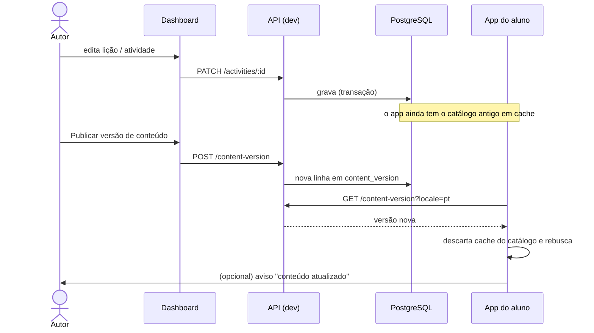

# Dashboard (`dashboard/`)

Ferramenta web **local** para gerenciar o currículo — áreas, módulos, lições e
atividades — nos dois idiomas, sem passar por Swagger, Postman ou edição manual do
`seed.ts`. É uma SPA de uma tela, tema escuro, **sem autenticação e sem router**,
pensada para rodar em `localhost`.

## Pré-requisito crítico

**A API precisa estar em `NODE_ENV=development`** (`pnpm api:dev`). As rotas de escrita
do catálogo só são registradas nesse modo; contra `pnpm api:start` ou a produção o
dashboard recebe 404. O dashboard escreve no **mesmo banco** que a produção — o que se
edita aqui é, de fato, o currículo real.

```bash
pnpm api:dev     # terminal 1
pnpm dash:dev    # terminal 2 → http://localhost:5173
```

## O que dá para fazer

- **Navegar** a árvore de uma área (módulos → lições → atividades) com o conteúdo de
  cada atividade renderizado por idioma.
- **Criar, editar, remover e reordenar** áreas, módulos, lições e atividades.
- **Ver o que falta traduzir**: um selo "sem pt" / "sem en" marca cada entidade sem
  tradução — a única defesa contra conteúdo meio-traduzido chegar ao app.
- **Conferir os termos de `highlight` ao vivo**, com a contagem de ocorrências, pela
  mesma regra que o app aplica.
- **Testar exercícios de código** (playground e desafio) numa sandbox, antes de salvar.
- **Marcar** uma lição como *aula de aprofundamento* ou *aula do baú*.
- **Publicar versão de conteúdo** (botão "Publicar") e **versão do app** (botão
  "Versão do app").
- **Exportar** qualquer recorte (área, módulo ou lição) em Markdown ou PDF, para
  revisão por um professor ou por uma IA.

## Como o conteúdo chega ao aluno



**Editar não basta: publicar é o que entrega.** Sem uma nova `content_version`, quem já
abriu o app continua com o catálogo antigo em cache. A publicação é **por idioma** —
se a edição cobriu pt e en, publique duas vezes.

## Stack

- Vite + React 19 + TypeScript (React fixado na mesma versão do app, para o workspace
  não hospedar duas cópias).
- Tailwind CSS v4 (tokens em `src/index.css`, sem `tailwind.config.js`) + shadcn/ui.
- TanStack Query para estado de servidor, `fetch` nativo para HTTP (sem axios, que no
  app existe por causa dos interceptors de token).
- react-hook-form + zod nos formulários; Playwright para validar a UI.
- Tipos da API por `codap-api: workspace:*`.

## Estrutura

```
dashboard/
  scripts/verifyUi.mjs       # validação de UI por Playwright
  src/
    api/                     # client.ts (fetch + ApiError), content.ts, queryKeys.ts
    components/
      ui/                    # shadcn — GERADO pelo CLI, não editar à mão
      tree/ forms/ export/   # árvore, diálogos de edição, exportação
    hooks/                   # toda chamada de API passa por um hook
    lib/                     # activitySchemas.ts (zod), mergeContent, reorder,
                             # exportMarkdown, highlight, playgroundDocument, …
    types/api.ts             # reexporta os contratos da API
```

## Decisões que não devem ser desfeitas sem motivo

- **A árvore é a junção de duas requisições** (`GET /modules` em pt e em en, juntadas por
  `id`). Não existe um endpoint "admin" multilíngue: `GET /modules` é o endpoint do app,
  com testes travando o formato.
- **"Sem tradução" e "tradução vazia" chegam iguais** da API; o dashboard trata nome
  vazio ou `content` sem chaves como ausência.
- **Cache longo, finito e em memória** (1 h / 24 h, definidos uma vez em `main.tsx`).
  Nunca persistente: um cache que sobrevive ao fechamento do navegador faria a edição
  seguinte partir de uma foto antiga do banco.
- **Os schemas zod (`lib/activitySchemas.ts`) são o único lugar onde o `content` é
  validado.** O zod descarta campos não declarados, então **um campo novo do contrato
  que falte no schema é apagado em silêncio ao salvar**. Mudou o contrato de um tipo?
  Mude o schema zod, o formulário e o `verify:ui` na mesma tarefa.
- **O campo `aditionalParagraph` da `option` tem um erro de digitação histórico** que
  está gravado no banco. **Não corrija** — quebraria todo o conteúdo semeado.
- **`lib/highlight.ts` é cópia fiel** do `ThemedHighlighter` do app. Se divergirem, a
  prévia mente. Mexeu em um, mexa no outro.
- **`lib/playgroundDocument.ts` espelha** o `buildSandboxHtmlDocument` do app (shim do
  `__codap_report`, CSP, proteção de laços). Os dois pacotes só compartilham tipos.
- **O PDF sai por `window.print()`**, sem biblioteca, a partir do mesmo modelo
  intermediário da exportação em Markdown. O `@media print` precisa esconder o portal
  dos diálogos do Radix.
- **Um `type` sem formulário dedicado cai no editor de JSON**, o que acompanha a postura
  da API de transportar o que não conhece.
- **A regra da persona do Cody** tem espelho no dashboard (`lib/theoryRules.ts`): a
  primeira teoria da lição precisa ser `cody`; as ações que deixariam uma teoria neutra
  como primeira ficam desabilitadas. O backend também recusa com 422.

## Formulários por tipo de atividade

`theory`, `option`, `code_blank`, `fill_blank`, `reorder`, `matching`, `code_playground`
e `code_editor` têm formulário tipado, com validação do formato (incluindo a regra de
**no máximo 30 caracteres por linha de código**). O formulário de `theory` tem uma
seção por área da tela (Introdução, Explicação, Código, Fechamento). Os formulários de
código têm botões de teste que rodam o exercício numa sandbox (`<iframe sandbox>`) e
mostram prévia, console e veredito. Ver [Tipos de atividade](referencia/tipos-de-atividade.md).

## Regras de código

- **Toda chamada de API passa por um hook** em `src/hooks/`; nunca `fetch`/`useQuery`
  solto em um componente.
- **Chaves de query nascem em `src/api/queryKeys.ts`.**
- Toda mutation invalida o **prefixo da área**, não a chave de um idioma só.
- Componente de apresentação não busca dado. Não edite `components/ui/` à mão.
- TypeScript estrito, sem `any`; tipos da API vêm de `codap-api` com `import type`.
- Prefira derivar valores na renderização a sincronizá-los com `useEffect`.

## Validação de UI (obrigatória)

Toda alteração que muda a interface precisa passar pelo Playwright antes de ser
considerada concluída:

```bash
pnpm api:dev      # terminal 1
pnpm dash:dev     # terminal 2
pnpm dash:verify  # terminal 3
```

O script abre um Chromium headless, percorre os fluxos, salva capturas em
`dashboard/.playwright/` (não versionado) e **falha se houver qualquer erro no console**.
É **somente leitura**: não escreve no banco. Na primeira vez, instale o navegador:

```bash
pnpm --filter codap-dashboard exec playwright install chromium
```

Ao criar uma tela ou fluxo, acrescente um passo em `scripts/verifyUi.mjs`. Sincronize
os passos pelo estado da UI, nunca por `waitForTimeout`, e conte nós renderizados em
vez de esperar um toast.

## Comandos

| Comando | O que faz |
|---|---|
| `pnpm dash:dev` | Dev server do Vite |
| `pnpm dash:build` | Typecheck (`tsc -b`) + build de produção |
| `pnpm dash:verify` | Validação de UI por Playwright |
| `pnpm --filter codap-dashboard lint` | oxlint |
