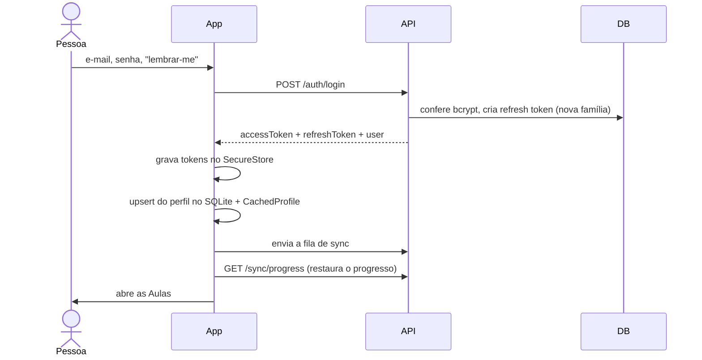
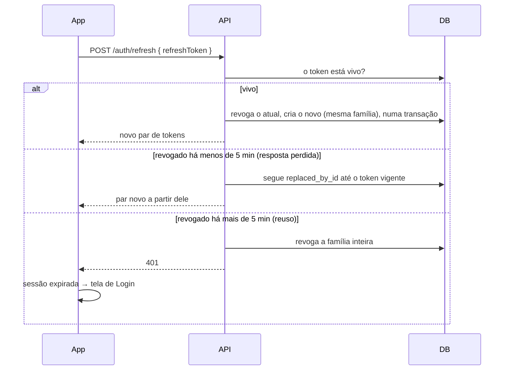

# Autenticação e sessão

Como a pessoa entra, permanece logada e sai — e por que a sessão sobrevive a um
servidor lento.

## Peças

| Peça | Papel |
|---|---|
| **Access token** | JWT de **15 minutos**, payload `{ id }`. Vai em `Authorization: Bearer`. |
| **Refresh token** | Valor aleatório de alta entropia (não é JWT). Só o **hash SHA-256** vai ao banco (`refresh_tokens.token_hash`). Vale **7 dias**, ou **60 dias** com "lembrar-me". |
| **Família** (`family_id`) | Liga toda a cadeia de rotações de uma sessão. Revogar a família derruba a sessão em todos os aparelhos daquela cadeia. |
| `SecureTokenStore` (app) | `expo-secure-store`: `refreshToken`, `accessToken`, `accessTokenExpiresAt`. |

> Por que SHA-256 e não bcrypt no refresh token? Ele é um segredo de alta entropia (não
> uma senha humana) e precisa de busca indexada por igualdade em toda renovação.

## Login



Detalhes:

- No **primeiro login** da conta, a API envia o e-mail de boas-vindas (a reivindicação
  é atômica: dois primeiros logins simultâneos mandam um só).
- O login **repete automaticamente** 2 vezes (após 5 s e 10 s) em falha de
  infraestrutura — é seguro repetir. Ver [Servidor lento](servidor-lento-e-nova-versao.md).
- Limite de 5 tentativas por minuto.

## Cadastro

`POST /auth/register` cria a conta e envia o e-mail de confirmação. **O app
deliberadamente não faz login automático:** ele revoga a sessão que o cadastro emitiu
(`/auth/logout`, melhor esforço) e leva a pessoa à tela de Login com o e-mail
preenchido — para ela escolher "lembrar-me" explicitamente.

Se a resposta do cadastro se perde na rede (a conta foi criada, o app não soube), o app
guarda o e-mail; um **409** logo depois para o mesmo e-mail é tratado como **sucesso**.

## "Logado" nunca depende de rede

`useAuthSession` só verifica se existe um refresh token no SecureStore. Isso decide a
rota inicial (`Home` ou `Login`) antes de esconder a splash. Abrir o app sem rede com
sessão guardada leva direto às Aulas.

## Renovação do access token

O interceptor de requisição do `ApiClient` renova o token **antes** de cada chamada
autenticada que esteja perto de expirar (via `/auth/refresh`).



Regras:

- **Uma renovação por vez no app** (promessa compartilhada em `ensureFreshAccessToken`).
  No boot, vários processos pedem token quase juntos; sem isso cada um leria o mesmo
  refresh token e a API trataria o segundo como reuso, derrubando a sessão.
- **Rotação com revogação condicional** (`updateMany` onde `revoked_at` é nulo): com
  duas rotações simultâneas do mesmo token, a segunda não atualiza nada, a transação
  desfaz e a família termina sempre com **um** token vigente.
- **Janela de tolerância de 5 minutos** (`REFRESH_REUSE_GRACE_MS`): um token recém
  rotacionado e reapresentado é tratado como *resposta perdida*, não como roubo. Existe
  por causa do servidor lento: o app desiste por tempo, a API conclui a rotação depois,
  e sem a tolerância a tentativa seguinte deslogaria a pessoa. A cadeia seguida tem no
  máximo 5 elos e nunca "ressuscita" revogações de logout ou de família.
- **Reuso fora da janela** revoga a família inteira (provável roubo).
- **Falha de rede na renovação nunca lança**: o app segue com o token em cache e a
  chamada falha naturalmente offline. O timeout da renovação é de 30 s — **mantenha
  abaixo** da janela de 5 min e acima do pior caso legítimo (banco acordando).

## Sessão expirada

Um 401 no `/auth/refresh` significa que o refresh token foi rejeitado de verdade
(revogado, expirado ou reuso). O app limpa o SecureStore e chama
`AuthStore.expireSession()`; um efeito em `App.tsx` zera o usuário, reinicia a pilha
em `Login` e mostra o aviso "sessão expirada". O logout manual usa `clearSession()` e
não mostra aviso.

## Logout

`POST /auth/logout` revoga o refresh token **deste** dispositivo (idempotente,
melhor esforço, sem esperar o servidor acordar). O app limpa o SecureStore e cancela os
lembretes.

## Redefinir ou trocar a senha

`POST /auth/reset-password` troca a senha e **revoga todos os refresh tokens da conta**,
inclusive o do aparelho que pediu. Por isso, depois de definir a senha nova no
navegador, o app cai no fluxo de "sessão expirada". Ver [Contas e e-mails](contas-e-emails.md).

## Rotas autenticadas no app

O interceptor pula o `Authorization` nas rotas `/auth/*` que **não** são de conta
logada. As que são (`/auth/me`, `/auth/resend-verification`,
`/auth/request-password-change`, `/auth/change-email`) estão em
`AUTHENTICATED_AUTH_ROUTES`. **Rota nova de conta logada sob `/auth/` precisa entrar
nessa lista**, senão a chamada vai sem Bearer e falha com 401 sem erro óbvio.

## Para proteger uma rota nova

```ts
fastify.get('/algo', {
  preHandler: fastify.authenticate,
  schema: { /* … */ }
}, async (request) => {
  const userId = request.user.id   // sempre do token, nunca do corpo
})
```
