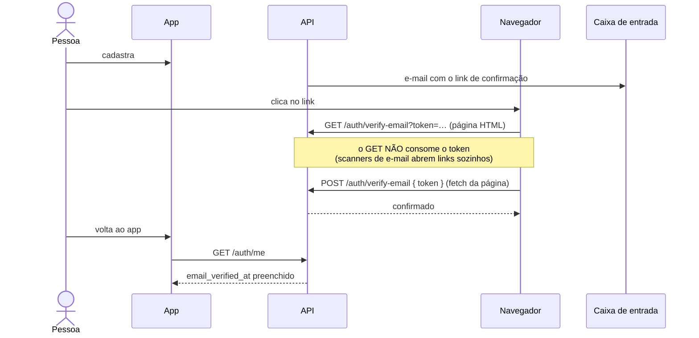

# Contas e e-mails

Confirmação de e-mail, recuperação e troca de senha, e correção de endereço.

## A regra que orienta tudo

> **Senha só com o e-mail confirmado.**

Um endereço não confirmado pode ser um erro de digitação que aponta para um estranho.
Se o link de redefinição fosse para lá, quem o recebesse assumiria a conta. Por isso:

- `forgot-password` e `request-password-change` **só emitem o token** se o e-mail está
  confirmado (`isEmailConfirmed`);
- `reset-password` **confere de novo** ao consumir o token (o e-mail pode ter mudado);
- a redefinição **não** confirma o e-mail como efeito colateral;
- a confirmação, por sua vez, **não bloqueia o login** (contas antigas têm
  `email_verified_at` nulo).

## Envio de e-mails

O plugin `mailer` fala com a **API HTTP do Resend** via `fetch` (sem SDK nem SMTP).

- `mailer.send()` é **assíncrono e nunca lança**: enfileira e volta. A latência do
  provedor não pode aparecer em `/auth/forgot-password` (revelaria se a conta existe), e
  um provedor fora do ar não derruba um cadastro já gravado.
- Sem `RESEND_API_KEY`, nada sai: em dev o texto (com o link) vai para o **log da API**;
  em produção vira um erro no log.
- Nos testes, o transporte é trocado por uma caixa em memória (`outboxOf(app)`): nenhum
  teste manda e-mail de verdade.
- Os links apontam para páginas servidas **pela própria API** (`PUBLIC_URL`), porque o
  app é mobile e não há site web para abri-los. `PUBLIC_URL` é obrigatória fora de dev.

Os três e-mails (confirmação, recuperação e boas-vindas) e o aviso de "senha alterada"
têm texto provisório em pt-BR (`utils/emailTemplates.ts`); a conta não guarda idioma.

## Tokens de e-mail

Tabela `auth_tokens`: valor aleatório de alta entropia, só o hash SHA-256 é guardado.

| Tipo | Validade |
|---|---|
| `email_verification` | 24 h |
| `password_reset` | 1 h |

- **Uso único.** `consumeAuthToken` gasta o token com um `updateMany` condicional em
  `used_at: null`, **dentro da transação** que aplica o efeito: se algo falhar depois,
  o token volta. É isso que segura duas requisições simultâneas com o mesmo link.
- Emitir um token apaga os anteriores ainda não usados do mesmo tipo (só o mais recente
  vale) e há **intervalo de 1 minuto** entre dois e-mails do mesmo tipo para a conta.

## Confirmar o e-mail

No app, `EmailStatusStore` guarda se o e-mail está confirmado (`null` = ainda não se
sabe). **O app nunca grava isso por conta própria**: só o servidor diz, via `GET /auth/me`.
A consulta acontece ao entrar, ao voltar ao primeiro plano e ao focar o Perfil — porque a
confirmação acontece fora do app. Sem rede, nada é afirmado.

- **Na abertura**: na primeira resposta "não confirmado" da sessão abre o
  `EmailVerificationModal`. Abrir **não manda e-mail**; só o botão "Reenviar" manda
  (com contagem de 60 s). Fechar nunca é um beco sem saída: a linha **"Confirmar
  e-mail"** do Perfil (com selo "Pendente") reabre o modal.
- **Corrigir o e-mail**: `POST /auth/change-email` só funciona **enquanto o atual não está
  confirmado** (é o conserto de um erro de digitação; uma sessão roubada não pode trocar o
  e-mail de uma conta confirmada). Apaga todos os tokens da conta e envia a confirmação ao
  endereço novo. 409 se já é de outra conta; 400 se é o mesmo, reservado ou de domínio
  suspeito.

## Domínios com erro de digitação

`register` e `change-email` recusam (400) `gmial.com`, `hotmial.com`, `.con`, `.com.b` e
similares — uma lista curta e de alta confiança, não uma checagem de DNS. **Só fora de
desenvolvimento.** O erro vem com `code: 'email_typo'` e `suggestion`; o app usa os dois
para escrever a mensagem no idioma da pessoa e oferecer "Usar fulano@gmail.com".

## Esqueci minha senha

Link logo abaixo do campo de senha do Login. A resposta do servidor é **sempre a mesma**
(200), exista a conta e esteja o e-mail confirmado ou não — a tela só diz "se estiver
cadastrado e confirmado, o link está a caminho", e explica a regra antes de enviar.

## Alterar senha (conta logada)

No Perfil. Sem e-mail confirmado, abre a confirmação. Com e-mail confirmado, o modal
mostra **para onde o link vai** e avisa que a pessoa será **desconectada de todos os
aparelhos** ao salvar a senha nova. A senha é criada numa página da API aberta pelo link,
no navegador; ao salvar, `reset-password` revoga todas as sessões, manda um e-mail de
"sua senha foi alterada" e o app cai no fluxo de sessão expirada.

## Erros

O servidor decide a **causa** (status e `code`); o texto vive no i18n do app
(`accountErrors.*`), então sai no idioma da pessoa. Erros novos que o app precise tratar
pela causa devem seguir esse formato e ser declarados no schema de resposta
(`authErrorResponseSchema`) — senão o serializador apaga `code`/`suggestion`.

## Conta de teste

`teste@teste.com`, **só em `NODE_ENV=development`**: cadastra e entra normalmente, conta
como confirmada e o mailer a ignora (o texto com o link vai para o log da API, para dar
para exercitar a troca de senha de ponta a ponta). Fora de dev, cadastro dá 400 e login dá
401 com a mesma mensagem de credencial inválida, mesmo que a linha exista no banco. O
ambiente é lido **a cada requisição**, não no boot.

## Rate limits

`forgot-password` 3/min · `reset-password` 5/min · `verify-email` 10/min ·
`resend-verification` e `request-password-change` 3 por 10 min · `change-email` 5 por 10 min.
