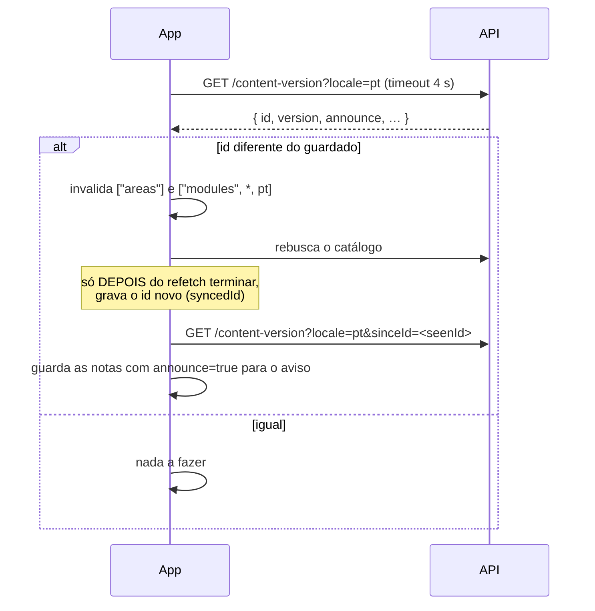

# Conteúdo e versionamento

Como o currículo chega ao app e como mudá-lo **sem publicar uma versão nova do aplicativo**.

## Dois eixos de versão — não misturar

| | `content_version` | `app_version` |
|---|---|---|
| **Diz** | "há conteúdo novo" | "há um aplicativo novo para baixar" |
| **Publicada** | Dashboard → botão "Publicar" | Dashboard → botão "Versão do app" |
| **O app faz** | Descarta o cache do catálogo e rebusca (e avisa, se quiser) | Mostra um aviso com link para a página de download |
| **Compara por** | `id` da publicação (nunca pela string) | **semver** com o `version` do `app.json` |
| **Obrigatória?** | Sim, para o conteúdo editado chegar | Só se há um novo APK |

## O catálogo no app

- Vem de `GET /areas` e `GET /modules` (ver [Lição e atividades](licao-e-atividades.md)).
- É guardado pelo React Query com `staleTime` e `gcTime` **infinitos** e persistido em
  AsyncStorage (`queryPersister.ts`): sobrevive a um kill do processo e funciona offline. O
  SQLite nunca guarda conteúdo (seria redundante).
- O cache só é revalidado quando alguém o **invalida** — quem faz isso é o
  `useContentVersionSync`.
- `persistOptions.buster` (`App.tsx`): mudar essa string descarta **todo** o cache
  persistido na próxima abertura. Regra prática: **mudou conteúdo ⇒ publique uma
  `content_version`; mudou um tipo de `contracts.ts` ou uma chave de query ⇒ bumpe o
  `buster`** (o app foi recompilado e o cache antigo tem uma forma que o código novo não
  sabe ler).

## `content_version`: atualizar conteúdo sob demanda

Decisões que não devem ser desfeitas sem entender o porquê:

- **Compara por diferença, pelo `id`.** Cobre rollback (que é uma linha nova, de `id` maior
  mesmo com versão menor) e evita semver no cliente (`"0.0.10" > "0.0.9"` é falso como texto).
- **Só o idioma atual é invalidado.** Um idioma de suporte parcial não rebusca porque outro
  mudou. As áreas (sem idioma na chave) acompanham qualquer publicação.
- **A versão só é gravada depois do refetch.** Gravar antes seria uma falha silenciosa e
  permanente: com a rede caindo no meio, o app ficaria com versão nova e conteúdo velho.
- **Roda dentro do `PersistQueryClientProvider` e depois de `useIsRestoring`**: invalidar
  durante a restauração do cache é corrida.
- **Nunca bloqueia nem alerta.** Sem rede, API fora do ar ou sem versão publicada, não faz
  nada e o aluno segue estudando offline.
- **Timeout de 4 s** só na consulta de versão (o payload é ~100 bytes; o catálogo, ~150 KB
  por idioma, pode demorar mais numa rede lenta e não herda esse teto).
- A versão local fica em AsyncStorage (`ContentVersions`), **junto do cache** que ela
  protege: se um sumir o outro também some.

### Publicar

`POST /content-version` (só em desenvolvimento) recebe `{ locale, version, changelog,
announce? }`. `released_at` é do servidor. **409 se a versão for igual à vigente** do
idioma; versão **menor é permitida** (rollback). O padrão de `version` (`X.Y.Z`) é
escrito com `[0-9]` e `[.]` — não com `\d` e `\.` — porque em string JavaScript uma barra
a menos vira outra coisa em silêncio. O dashboard espelha esse padrão em
`lib/contentVersion.ts`.

## Aviso de "conteúdo atualizado"

Quando uma publicação tem `announce = true`, o app mostra o que mudou — o `changelog` é
**escrito para o aluno**, exatamente o texto que aparece.

- **Dois marcos por idioma**: `syncedId` (o conteúdo que o cache reflete) e `seenId` (a
  última publicação de que a pessoa foi avisada). Separados, o conteúdo troca quando chega
  (em segundo plano, talvez no meio de uma lição) e o aviso espera uma pausa natural.
- **Quem busca as notas é a sincronização; quem mostra é a aba Aulas**, só ao ganhar foco
  (`useFocusEffect`) — ao abrir o app ou voltar de uma lição, nunca no meio de uma.
- **Informa, não decide**: um botão só ("Entendi"). O conteúdo já foi atualizado; fechar não
  desfaz nada.
- Mostra a mais nova em destaque, até mais duas anteriores e "e mais N".
- **Nunca aparece na primeira instalação nem na primeira vez num idioma** (sem estado
  anterior, nasce como "visto").
- Publicação sem `announce` é **silenciosa** (correção de digitação não deve interromper
  ninguém). O padrão da coluna é falso; o formulário do dashboard liga por padrão.

## `app_version`: avisar de um novo aplicativo

Ver [Servidor lento e nova versão](servidor-lento-e-nova-versao.md#aviso-de-nova-versão-do-app).

## Ordem de publicação

Quando uma mudança toca banco, API e app, a ordem é sempre:

> **migration → API → app → `content_version`**

Exemplos reais: aulas de aprofundamento e aulas do baú precisam de campos que um app
antigo não conhece. Se uma `content_version` fosse publicada antes de os alunos terem o app
novo, as lições opcionais apareceriam como lições obrigatórias da trilha. Para teoria no
modelo novo (`introduction`/`explanation`), **publique o app (que lê os dois formatos) antes
de migrar o banco**.

## Armadilhas

- `GET /modules` serializa o `content` com `additionalProperties: true`. Sem isso o
  `fast-json-stringify` apaga o JSONB inteiro em silêncio, sem erro nem aviso (há um teste
  `deepEqual` travando isso).
- Uma lição concluída que depois é removida do catálogo fica órfã em `UserLessons`
  (inofensiva na interface); o evento de `/sync` falha por FK e vira `failed` (terminal).
  O XP divergente se corrige quando o app adota o `profile`.
- Idiomas: `GET /modules` ainda valida `locale` por `enum: ['pt','en']`; já
  `content-version` e `app-version` validam contra a tabela `locales`. Suportar um terceiro
  idioma exigiria mexer no primeiro.
