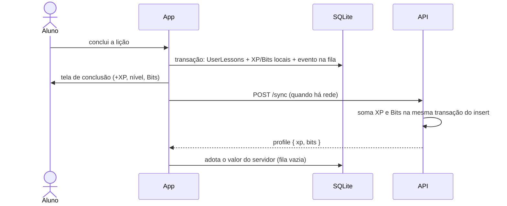

# Gamificação: XP, níveis, Bits e conquistas

A gamificação existe para dar **motivação, nunca obstáculo**: nenhuma lição da trilha
principal fica trancada por nível, moeda ou sorte.

## Princípios

- **XP é progresso e nunca é gasto.** Define o nível.
- **Bits são a moeda.** Vêm de subir de nível e são gastos na [loja](loja-e-bau.md).
- **Nível e XP aparecem no Perfil e na tela de conclusão**, não nas trilhas.
- **Offline-first**: o nível reage na hora, sem rede. O SQLite é a fonte da verdade
  local; a nuvem recebe e corrige.

## XP e nível

O nível (de 1 a 50) é **derivado** do XP por uma curva fixa. Para *alcançar* o nível `n`:

```
threshold(n) = round(0,41 · (n−1)² + 54 · (n−1))      n = 1 … 50
```

| Nível | XP necessário | Marco |
|---|---|---|
| 2 | 54 | primeira subida em ~6 lições |
| 10 | 519 | fim da trilha de HTML |
| 19 | 1 105 | HTML + CSS |
| 30 | 1 911 | trilha principal toda |
| 50 | 3 630 | só alcançável com conteúdo opcional |

Cada lição da trilha paga **10 XP** (`LESSON_XP_REWARD`); uma aula de aprofundamento ou do
baú paga o `xp_reward` próprio (1 a 100). Acima do nível 50 o XP continua somando e o
nível fica em 50.

> A curva e as constantes existem **duas vezes**: `api/src/utils/levels.ts` e
> `app/src/utils/levels.ts` (o app importa a API só como tipo). **Mudou uma, mude a outra.**

## Bits

Ao alcançar o nível `n` (n ≥ 2) o aluno ganha **`10 × n` Bits**, só ao *cruzar* o nível.
Uma lição que cruza vários níveis paga todos. Até o nível 10 isso soma 540 Bits.

Não há Bits retroativos: quem já tinha XP antes de os Bits existirem só passa a ganhar ao
subir de nível. Não há log de compras — o saldo é ganhos − gastos.

## Como o XP é concedido



- **Só a primeira conclusão rende.** Refazer uma lição mostra "já concluída" e nada mais.
- **XP local = estimativa imediata**; o servidor é a autoridade. A adoção do `profile`
  corrige reinstalação, outro aparelho e lição removida do catálogo.
- **Dobro de XP** (comprado na loja): se o `occurredAt` do evento cai dentro de uma janela
  `xp_boosts`, o XP é dobrado (e os Bits dos níveis cruzados por esse XP maior). O servidor
  limita cada janela a **5 lições** dobradas.

## Tela de conclusão

`LessonComplete` mostra "+10 XP", a barra (`LevelBar`, a mesma do Perfil) animando do
progresso anterior ao novo e, numa subida, "Nível N!" com os Bits. Se a barra enche, ela
recomeça e segue até o valor novo. Com "reduzir movimento" ligado, mostra o estado final.

## Aulas de aprofundamento

Lições **opcionais** (`lessons.min_level` entre 2 e 50). No app:

- abrem a partir do nível mínimo (calculado do XP local — funciona offline);
- ficam **apagadas, com borda tracejada, cadeado e "Nível N"** enquanto bloqueadas, e não
  respondem ao toque; liberadas ganham borda roxa e um foguete;
- pagam o XP próprio (`xp_reward`, padrão 10);
- **nunca contam para o emblema da área** (`isAreaComplete` as ignora).

As regras vivem em `app/src/utils/lessonAccess.ts` (`isOptionalLesson`,
`isLessonUnlocked`, `lessonXpReward`). Uma lição **sem** `minLevel` — inclusive de um cache
antigo, que ainda não traz o campo — é da trilha principal. Existem 9 aulas (3 por área),
no módulo Avançado.

> **Limitação**: o servidor **não confere `min_level`** no `/sync`. Um cliente adulterado
> que abra uma aula bloqueada só ganha o XP dela. Conferir reprovaria eventos de um mesmo
> lote que dependem uns dos outros (rodam em paralelo).

## Conquistas

Quatro emblemas, numa grade 2×2 aberta pelo Perfil: **HTML**, **CSS**, **JavaScript**
(concluir todas as lições exigidas da área) e **Tríade Web** (ter os três).

- **Ids fixos**: `html: 1, css: 2, javascript: 3, webTriad: 4` — em `ACHIEVEMENT_IDS`
  (`AchievementService.ts`) e nos `ACHIEVEMENTS` do `api/prisma/seed.ts`. A conquista é
  decidida **no app, offline**, e viaja ao `/sync` só pelo id. Sem a linha no banco o evento
  falha por FK (`achievement_not_found`) e fica `failed`.
- **Nenhuma requisição para ler o status.** Uma conquista obtida nunca volta atrás. O
  SQLite (`UserAchievements`) é a fonte da verdade; a `AchievementStore` (memória) é carregada
  uma vez por usuário e por sessão.
- **Quando confere**: logo após `recordLessonCompletion`, só a área daquela lição e a Tríade.
  A primeira carga faz uma conferência completa e retroativa.
- **"Área concluída"** (`isAreaComplete`): todas as lições da área **com ao menos uma
  atividade jogável** estão em `UserLessons`. Aulas de aprofundamento e do baú ficam fora.
  Lição sem atividade suportada (abre "em breve") não conta. O catálogo vem do **cache** do
  React Query; sem cache a área nunca foi aberta no aparelho.
- **Visual**: obtida = emblema colorido; não obtida = silhueta em baixo-relevo (a própria
  imagem tingida, em três camadas). Toque numa obtida abre um destaque (`AchievementSpotlight`)
  com brilho pulsante (desligado com "reduzir movimento").
- **Só em `__DEV__`**: segurar um emblema por 5 s inverte como ele aparece, sem tocar no
  SQLite, na fila nem na store.

Conquistas também voltam do servidor ao entrar numa conta nova
([Sincronização](sincronizacao-e-progresso.md#volta-restaurar-o-progresso)).

## Conta mestra

Uma conta de testes com tudo liberado, para demonstrar e testar o app inteiro sem jogar:
nível máximo, todas as aulas concluídas (inclusive as de aprofundamento e do baú), todas as
conquistas e todos os baús revelados.

- **Liga-se só por SQL**: `UPDATE users SET is_master = true WHERE email = '…'`. A coluna
  `users.is_master` (padrão falso) não aparece em nenhuma resposta da API, nenhuma rota a escreve
  e o app não sabe que ela existe. Não há "código secreto" no app, que seria extraível do APK.
- **Concessões reais, não respostas falsas**: a cada `POST /auth/login` e `GET /sync/progress`
  de uma conta mestra, o servidor garante (idempotente, `createMany` com `skipDuplicates`) as linhas
  de `user_lessons`, `user_achievements` e `user_chest_lessons` e eleva `users.xp` ao XP do nível 50.
  Por isso loja, coleção e restauração de progresso funcionam sem caso especial, e aula ou
  conquista nova aparece concluída na próxima abertura. Código em `api/src/utils/masterAccount.ts`.
- **Bits não são concedidos pela função**: o saldo de teste (3 000) é dado uma única vez, direto
  no banco, quando a conta é preparada. Gastou na loja? Ajuste `users.bits` por SQL.
- A conta é criada normalmente pelo app (ou direto no banco, sem disparar e-mail, para ainda
  poder demonstrar a confirmação de e-mail e as boas-vindas). Troque a senha logo em seguida.

## Perfil

Cartão de identidade (avatar, nome, e-mail) com **Nível N**, "atual / necessário XP" e a
barra até o próximo nível, e os Bits no canto. Depois, as linhas: Editar perfil, Confirmar
e-mail (se pendente), Alterar senha, Conquistas e Sair.

## Fora de escopo (por ora)

Cosméticos, cronômetro de aula, desafios com tempo, conquistas de completude por aula,
indicação de nível dentro das trilhas e revisão espaçada. Ver [Roadmap](../roadmap.md).
