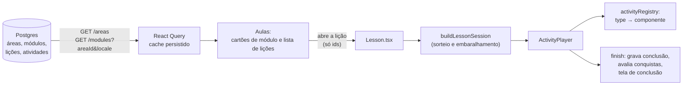

# Lição e atividades

Como uma lição sai do banco, vira uma sessão de estudo no app e termina em XP.

## Do catálogo à tela

- `GET /areas` devolve as áreas (sem idioma). `GET /modules?areaId=&locale=` devolve os
  módulos de **uma área, com lições e atividades aninhadas**, já traduzidos — uma única
  chamada de payload grande, de propósito: o cache é infinito e persistido, então custa
  uma requisição por área na primeira abertura, contra N requisições sob demanda.
- A área padrão é `areas[0]` (HTML). A área efetiva é **derivada**
  (`pickedAreaId ?? areas[0].id`), não sincronizada por `useEffect`.
- Ícones, cores e imagens de área/módulo vêm de `areaMetadata.ts`, por **posição** no
  array (nunca por `id`).
- Nunca chame `useModulesQuery` com `areaId` indefinido: uma query desabilitada por
  `enabled` ainda registra a entrada no cache, deixando uma chave órfã para sempre.
  Enquanto a área não está resolvida, a tela mostra o esqueleto.

## A lista de lições

| Estado do botão | Aparência | Regra |
|---|---|---|
| Normal | Cartão simples; marca de concluída quando está em `UserLessons` | — |
| Desafio do módulo | Borda dourada e troféu | Lição que tem uma atividade `code_editor` (não há campo no banco) |
| Aprofundamento liberado | Borda roxa sutil e foguete | `minLevel` ≤ nível do XP local |
| Aprofundamento bloqueado | Apagado, tracejado, cadeado e "Nível N"; **não responde ao toque** | `minLevel` > nível |
| Aula do baú | Borda magenta e caveira; sempre aberta | Revelada no Baú Surpresa; encaixada no fim do módulo dela |
| "Em breve" | Aviso | Lição sem nenhuma atividade que o app saiba reproduzir |

O título pode quebrar em várias linhas — o cartão tem altura *mínima*, não fixa.

## A sessão

A tela `Lesson.tsx` **não entrega `lesson.activities` direto ao player**: passa por
`buildLessonSession()` (função pura, não muta o cache):

1. A **teoria** (`type === "theory"`) vem primeiro, na ordem do `index`, **nunca
   aleatorizada**.
2. A **prática** vem depois:
   - atividades com o mesmo `content.pool` são alternativas entre si; a sessão sorteia
     `draw` delas (padrão 1; sem `pool`, sempre aparece);
   - a lista de prática é **embaralhada**;
   - cada `option` sem `fixedOrder` tem as alternativas embaralhadas e o `correctOption`
     remapeado — por isso o conteúdo grava a correta sempre na posição 1.
3. O sorteio fica num `useMemo` por `[lesson.id, idioma]`: um refetch que devolve a mesma
   lição não re-sorteia no meio da sessão; trocar o idioma re-sorteia e zera o índice.

Verdadeiro/falso **não é um tipo**: é uma `option` com duas alternativas e `fixedOrder: true`.

## O player e a registry

`ActivityPlayer` percorre as N atividades, calcula o progresso e despacha cada uma pelo
`type` para o renderizador registrado em `ACTIVITY_REGISTRY` (`activityRegistry.tsx`):

`theory` · `option` · `code_blank` · `fill_blank` · `reorder` · `matching` ·
`code_playground` · `code_editor`

- **Tipo novo = uma entrada na registry** (mais contrato, formulário no dashboard e
  galeria).
- `filterPlayable()` descarta o que não está na registry **antes** de entrar no player —
  uma atividade desconhecida não trava ninguém numa etapa em branco e a barra de progresso
  não mente. É isso que deixa um app antigo conviver com um tipo novo no banco (a lição
  só mostra uma atividade a menos).
- Cada renderizador recebe `activityKey` e o usa como `key` do componente. **É
  obrigatório**: sem ele, duas `option` seguidas reaproveitam a instância e a segunda herda
  a alternativa marcada e o estado do modal da primeira.
- Todas as atividades usam a casca `LessonScreen` (cabeçalho com fechar, título, barra de
  progresso "N de M" e ajuda; rolagem; botão "Seguinte" fixo no rodapé; degradês).

## Conclusão da lição

Ao terminar a última atividade, `Lesson.tsx`:

1. `recordLessonCompletion(userId, lessonId, xpReward)` → grava `UserLessons`, soma XP e
   Bits (dobrando se houver janela ativa), enfileira o evento e dispara o envio. Devolve
   um `LessonCompletionResult` (`firstTime`, `xpGained`, `bitsGained`, níveis antes/depois,
   `boosted`).
2. `evaluateAfterLesson` → decide, offline, se algum emblema foi desbloqueado.
3. Mostra `LessonComplete`: "+10 XP", a barra de nível animando e, se subiu, "Nível N!" e
   os Bits ganhos. Refazer uma lição mostra "você já tinha concluído esta lição". Com
   "reduzir movimento" ligado, mostra direto o estado final.

Lição bloqueada aberta à força (deep link) é barrada por `LessonLocked` e não paga nada.
Ver [Gamificação](gamificacao.md).

## Atividade de teoria: as quatro áreas

`TheoryActivityContent` tem: **introdução** (`title?`, `text`, `persona`) → **explicação**
(opcional) → **código** → **fechamento** (opcional, em um cartão complementar). Só a
introdução é obrigatória.

- **Persona** é só do *texto*: `cody` (acolhedor, conversacional) ou `neutral` (direto). A
  tela é a mesma. **A primeira teoria de cada lição deve ser `cody`** — regra aplicada pela
  API (422) e espelhada no dashboard. O app não mostra avatar do Cody por conta própria.
- `normalizeTheoryContent` é a única porta de entrada: devolve sempre o modelo novo e
  converte o antigo (`firstParagraph`…), para o app novo funcionar contra um banco ainda
  não migrado.
- **Destaques** (`highlight`): termos que o app pinta na prosa, por palavra inteira e sem
  diferenciar maiúsculas. Um termo escrito como `<tag>` destaca só o nome da tag.
  **Termos viram expressão regular sem escape** — um metacaractere (`(`, `[`, `+`, `?`)
  quebra o destaque. Confira no dashboard, que mostra a contagem de ocorrências.

### Editor de código da teoria

O `CodeSection` é um cartão único (460 dp) com uma aba por bloco de código, uma aba "Web"
e o botão Copiar:

- **Aba "Web"** (omitida quando `onlyCode: true`): combina os blocos HTML/CSS/JavaScript
  num só documento (`buildSandboxHtmlDocument`) numa WebView. Executa JavaScript de
  verdade como *preview passivo*; `console.*` e erros aparecem num painel. TypeScript e
  JSX nunca entram nessa combinação.
- **Terminal** (`TerminalSection`): botão "Executar" + saída, para lições de lógica pura
  sem DOM. A elegibilidade vem do código (`codeLanguage === "JavaScript"`, a menos que
  `noTerminal`), ou do campo `terminalCode`, um JavaScript executável que roda **no lugar**
  do exibido (para TypeScript pré-transpilado ou JavaScript "simulado"). Roda numa WebView
  fora de tela, remontada a cada toque; tem *watchdog* de ~4 s.
- **`JSX` e `TypeScript` nunca executam** (sem transpilador embarcado, de propósito).

## Sandbox de código

Os exercícios `code_playground` e `code_editor` rodam **código do aluno** numa WebView
isolada (`SandboxWebView` + `buildSandboxHtmlDocument`). Defesas em camadas:

| Defesa | O que faz |
|---|---|
| **CSP sem rede** | `default-src 'none'`: `fetch` e imagens remotas falham |
| **Navegação travada** | `onShouldStartLoadWithRequest` só deixa carregar o próprio documento; sem arquivos nem janelas novas; sem cache |
| **Proteção de laços** (`protectLoops`) | Um scanner reescreve `while`/`for`/`do…while` para checar o relógio na condição; o relógio é **por tarefa** (zera quando a tarefa termina). Lança "O laço foi interrompido" após ~1 s |
| **Console não repassado** | Evita afogar o processo do app com milhares de `console.log` |
| **Watchdog de 4 s** | Rede de segurança; no timeout a WebView é desmontada |
| **Correção travada** | `__codap_report`/`__codap_check` e o resultado ficam fixados (`Object.defineProperty`) para o código livre não burlar a correção |
| **Escape de `</script>`/`</style>`** | No código do aluno |

Por que a proteção de laços existe: no Android, um `while` sem fim com `console.log`
travou o app inteiro (ANR) mesmo com o watchdog — desmontar a WebView não interrompe o
JavaScript em execução. O mesmo documento é gerado também no dashboard
(`lib/playgroundDocument.ts`), onde é testado.

A correção é **pelo comportamento**: o `checkScript` autorado roda depois do código do
aluno, no `DOMContentLoaded`, e chama `__codap_report(passou, mensagem?)` (playground) ou
`__codap_check(rótulo, passou)` por requisito (desafio). Qualquer solução que funcione passa.

## Ajuda do desafio

No `code_editor`, a ajuda é progressiva: cada passo — as 1 a 3 dicas e, por fim, a
solução — abre a cada **2 execuções que não passaram ou 90 s**, o que vier primeiro. A
**Dica Instantânea** (comprada na loja) abre o próximo passo na hora. Concluir exige
passar; o código executado fica congelado (editar depois só marca o resultado como
desatualizado).

## Tutoriais

O ícone **"?"** do cabeçalho de toda atividade abre um tutorial de **como se faz** aquele tipo
de atividade — não do conteúdo da lição. Cada tipo (`theory`, `option`, `code_blank`,
`fill_blank`, `reorder`, `matching`, `code_playground`, `code_editor`) tem o seu, com 3 ou 4
passos: uma ilustração animada e um texto curto.

| Tipo | Passos |
|---|---|
| `theory` | ler com calma · explorar as abas do código · executar · tocar em Seguinte |
| `option` | ler o enunciado · escolher (e poder trocar) · confirmar com Seguinte |
| `code_blank` | achar as lacunas · tocar nos blocos · devolver um bloco |
| `fill_blank` | descobrir o que falta · digitar a resposta · conferir |
| `reorder` | linhas fora de ordem · tocar na ordem certa · corrigir devolvendo uma linha |
| `matching` | dois lados · um toque de cada lado · errou, tenta de novo |
| `code_playground` | completar as lacunas · Executar · ver se funcionou |
| `code_editor` | ler os requisitos · digitar (com a barra de símbolos) · executar e conferir · dicas e Dica Instantânea |

Como funciona por dentro:

- Quem abre o tutorial é a casca da atividade (`LessonScreen`), que recebe só **o tipo**; os
  componentes de atividade não guardam estado de tutorial.
- As ilustrações são **desenhadas em código** (`View` + `Animated`), sem GIF: seguem o tema
  claro/escuro, não pesam no bundle e podem ser ajustadas como qualquer componente. Cada uma é
  um laço de quadros — um dedo desliza até o alvo, "toca" e o desenho muda.
- Com **"reduzir movimento"** ligado, a ilustração fica parada no estado final.
- As figuras são decoração (o leitor de tela ignora) e o texto do passo carrega o sentido.
- O campo `tutorial: true` do conteúdo abre o tutorial já na entrada da atividade (a galeria
  escondida o usa para revisar todos).
- Textos em `tutorial.*` (pt e en), como texto de interface — não é conteúdo de lição.

## Conteúdo nunca vem do i18n

`src/translations/i18n/locales/{pt,en}.json` só guardam texto de **interface**. Todo
texto de lição vem da API. Para editar conteúdo, use o dashboard (e atualize o seed —
ver [Autoria de conteúdo](../guias/autoria-de-conteudo.md)); nunca crie uma chave de i18n
para texto de aula.
