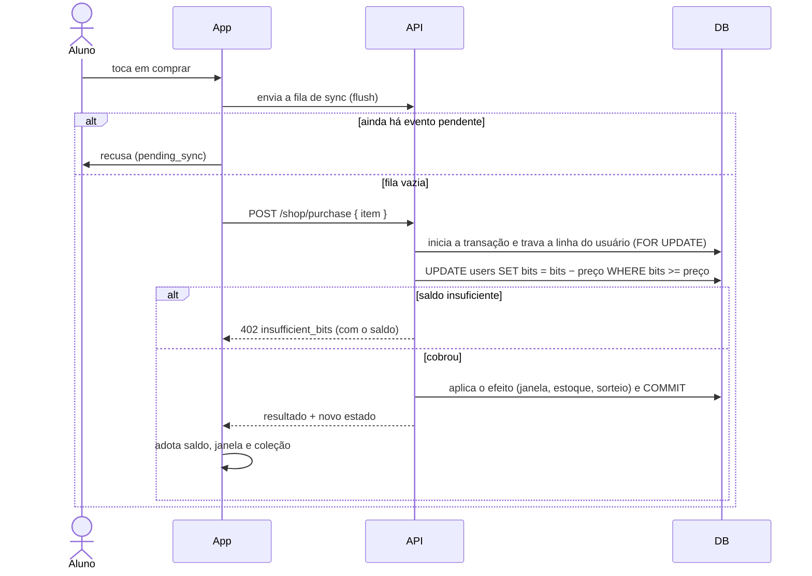

# Loja e Baú Surpresa

A loja faz os Bits **servirem para algo**. Nada da trilha principal depende dela.

## Itens

| Item | Preço | O que dá |
|---|---|---|
| **Dobro de XP** | 200 Bits | Uma janela de **5 minutos** em que as lições pagam o dobro de XP (no máximo 5 lições dobradas por janela) |
| **Dica Instantânea** | 300 Bits | +1 no estoque; usada no desafio de código para liberar a próxima ajuda na hora |
| **Baú Surpresa** | 500 Bits | Um sorteio (ver abaixo) |

Os preços moram no servidor (`api/src/utils/shop.ts`, `SHOP_PRICES`) e chegam por
`GET /shop`; o app só os exibe (`FALLBACK_PRICES` em `Market.tsx` apenas preenche a tela
enquanto o estado não chegou — sem o estado, a compra nem é oferecida).

## Regra de ouro: online, validado no servidor

**Comprar, usar a dica e abrir o baú exigem internet.** Um saldo gasto offline obrigaria a
desfazer compras quando o servidor discordasse. O servidor é a única autoridade do saldo.

- **Antes de comprar o app envia a fila**: os Bits de lições feitas offline só existem para
  o servidor depois disso; uma recusa por "saldo insuficiente" com o saldo local cobrindo
  seria incompreensível. Se um envio já está em andamento, o app o espera (até 10 s).
- **Cobrança atômica**: usuário travado (`FOR UPDATE`) e **decremento condicional**
  (`bits >= preço`). Duas compras simultâneas nunca gastam o mesmo saldo; compra recusada
  não cobra nem entrega. **Não troque por "ler, conferir, gravar".**
- **Timeouts**: compra e dica 20 s (acima dos 15 s da transação no servidor), leitura 10 s.
  Uma compra **sem resposta** (rede ou timeout) relê o estado na hora, porque o servidor
  pode ter cobrado. O app **nunca repete** uma compra sozinho.
- **Resposta perdida**: o próximo `refreshShop` (ao focar a loja ou abrir o desafio) corrige
  tudo: adota o saldo do servidor quando não há evento por enviar e invalida a coleção
  guardada se ela tem menos aulas do que o servidor diz que foram reveladas.

## Dobro de XP

Uma linha em `xp_boosts` (`starts_at`, `ends_at`). O `/sync` dobra o XP de toda
`lesson_completed` cujo **`occurredAt`** (hora do evento, não do envio) cai numa janela —
vale para lição feita offline e sincronizada depois. Comprar com janela ativa dá **409
`boost_active`**.

O app também dobra localmente (`Users.doubleXpEndsAt`, gravado pelo `refreshShop` e pela
compra) e mostra "XP em dobro!" na conclusão; o servidor é a autoridade e o `profile`
corrige a diferença. O teto de 5 lições por janela existe porque o servidor confia no
`occurredAt` do cliente — sem ele, atrasar o relógio do aparelho para dentro de uma janela
vencida dobraria tudo.

## Dica Instantânea

Estoque em `users.instant_hints`. `POST /shop/use-hint` gasta uma com um único `UPDATE`
condicional (`instant_hints > 0`, senão **409 `no_hints`**). No desafio de código, o botão
"Liberar agora" só aparece com estoque e abre o **próximo passo da ajuda**.

## Baú Surpresa

`rollChest` (função pura, gerador de números aleatórios injetável nos testes) sorteia:

| Resultado | Peso |
|---|---|
| Aula exclusiva ainda não revelada | 40 |
| Dica Instantânea | 25 |
| Dobro de XP | 20 |
| 250 Bits (reembolso parcial) | 15 |

- Sem aulas restantes, o peso da aula sai e os outros se renormalizam.
- **Garantia contra azar**: depois de 2 baús seguidos sem aula (`chest_misses`), o próximo
  é aula, se ainda houver.
- Um Dobro de XP sorteado com janela ativa abre a nova **logo depois** da atual.
- A resposta é um objeto **plano** (`chest.kind` + campos opcionais): um `oneOf` no schema
  faria o serializador lançar quando nada casasse.

### Aulas do baú e a coleção

Uma aula do baú é uma lição com `is_chest = true` (e nunca `min_level`).

- **Fica fora de `GET /modules`**: o catálogo é igual para todos e o app o guarda para
  sempre; a aula é *por usuário*. Quem a revelou a recebe por **`GET /collection`**.
- `GET /shop` informa só **quantas** aulas do baú cada área tem e quantas a pessoa já tem,
  **nunca quais** — a surpresa é parte do baú.
- No app, a aula revelada é encaixada **no fim do módulo** a que pertence (borda magenta e
  caveira — uma forma, não só a cor). `Lesson.tsx` procura a lição no catálogo **ou** na
  coleção. Uma aula do baú **não** entra na conta de "área concluída".
- O servidor recusa `lesson_completed` de aula do baú **não revelada** (`lesson_locked`).
- Remover uma aula/módulo/área que tenha aula do baú já revelada dá 409.
- O acervo inicial tem **6 aulas** (2 por área, 50 XP cada, no módulo Avançado):
  HTML — Custom Elements, Validação nativa de formulários; CSS — `@property`, Subgrid;
  JavaScript — Proxy e Reflect, Tagged templates.

## Limitações assumidas

- Não há log de compras: só o saldo e os estoques.
- O servidor não confere `min_level` no `/sync` (ver [Gamificação](gamificacao.md)).
- Em produção, o saldo só muda por `/sync` e `/shop` (o CRUD de `users`, que permitiria
  escrever XP e Bits sem autenticação, só existe em desenvolvimento).
