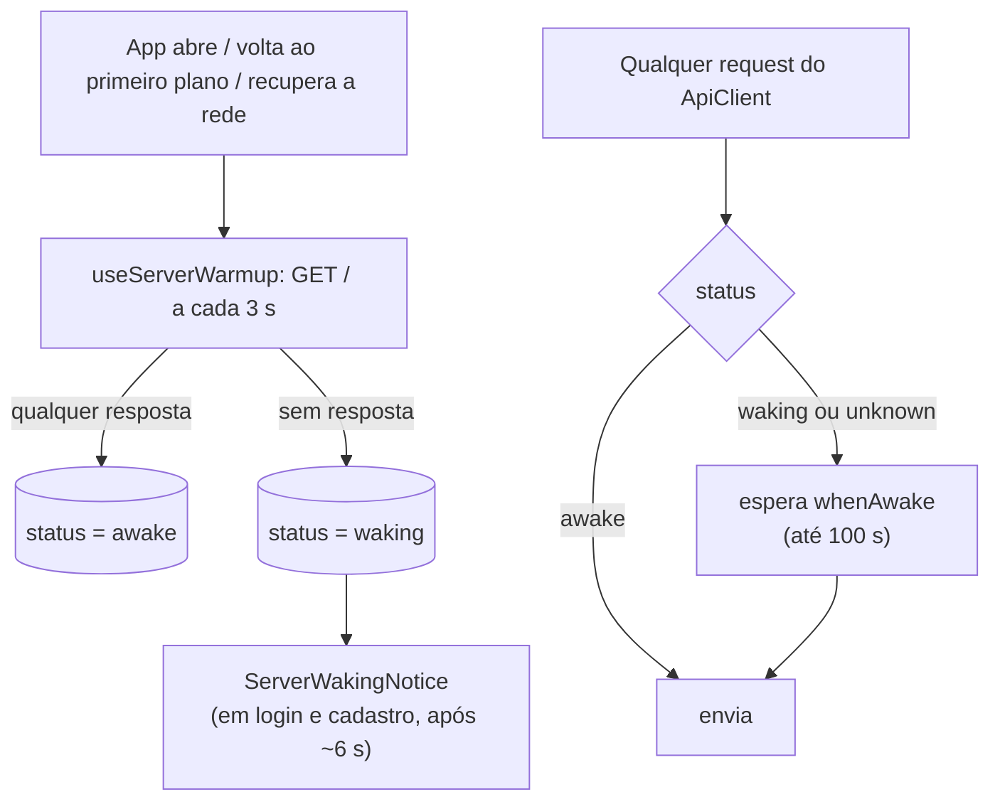
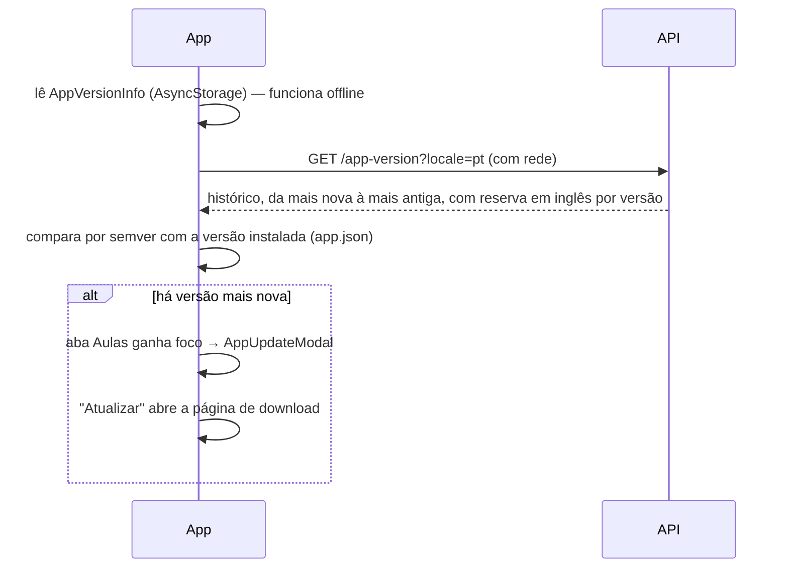

# Servidor lento e aviso de nova versão

## O problema: a API dorme

A API roda no plano gratuito do Render, que **dorme** depois de uns 15 minutos sem
tráfego e leva de 30 s a mais de 1 minuto para acordar (o banco Neon também "acorda").
O app foi desenhado para isso **sem bloquear a interface** — continua offline-first.

### Peças

- **`ServerWarmup.ts` + `useServerWarmup`** (em `App.tsx`, fora de qualquer tela): sonda
  `GET /` — a rota mais leve da API, sem banco — no boot, ao voltar do segundo plano depois
  de ~8 min sem sinal do servidor e ao recuperar a rede; repete a cada 3 s enquanto falha,
  por até 3 min. O estado (`unknown | waking | awake`) vive no `useServerStatusStore`. Vale
  para **qualquer** abertura, inclusive quem entra direto nas Aulas com "lembrar-me".
- **`ApiClient`**: todo request espera `whenAwake` (no máximo 100 s) antes de sair, para
  ninguém mandar um `/auth/refresh` ou um cadastro a um servidor que ainda não acordou.
  Qualquer resposta de verdade (inclusive 4xx e 500 da própria API; **502/503/504 não
  contam**) marca o servidor como acordado. Timeout padrão de **45 s** e de 30 s no refresh.
- **Sem nenhuma conexão** (`NetInfo.isConnected === false`, como no modo avião), o request
  **falha na hora** como erro de rede, em vez de esperar o timeout. Só `isConnected` conta,
  não `isInternetReachable`, para não travar o app em redes que impedem a sondagem.
- **Repetição automática** (`retries`/`retryDelayMs` no config do axios) **só em chamadas
  seguras de repetir** em falha de infraestrutura (sem resposta, 502/503/504): o **login**
  tenta mais 2 vezes (5 s, depois 10 s). **Cadastro, compras e envios que gravam não repetem
  sozinhos.** `noWait: true` (logout, melhor esforço, timeout de 8 s) não espera o servidor.
- **Cadastro com resposta perdida**: um 409 para o mesmo e-mail logo depois de uma falha de
  rede é tratado como sucesso ([Autenticação](autenticacao-e-sessao.md#cadastro)).
- **`ServerWakingNotice`** (só no login e cadastro): depois de ~6 s sem resposta mostra "O
  servidor está acordando. Isso pode levar até 1 minuto — pode esperar, o app tenta sozinho."
  e some quando ele responde. Respostas rápidas não mostram nada.
- **Ninguém é deslogado por lentidão**: a API tolera por 5 minutos um refresh token recém
  rotacionado ([janela de tolerância](autenticacao-e-sessao.md#renovação-do-access-token)).

### Do lado da infraestrutura

Um monitor externo (UptimeRobot, a cada 5 minutos, em `GET /` — tanto `HEAD` quanto `GET`
respondem 200) mantém a API acordada boa parte do tempo. O plano gratuito do Render dá
**750 horas por mês por workspace**; passar disso suspende os serviços gratuitos até o mês
seguinte. A alternativa estudada para o futuro é o Cloud Run (camada gratuita).

### Testar sem o Render

Suba um servidor falso que responde 503 por ~25 s (como o Render acordando) e aponte um
Metro de teste para ele com `EXPO_PUBLIC_API_URL=http://10.0.2.2:<porta>`. **Não reinicie o
Metro de quem está desenvolvendo** (porta 8081).

## Aviso de nova versão do app

O app **não está na Play Store**. A página oficial
(`https://codap.gabrielsimoesdeveloper.com.br`, `APP_DOWNLOAD_URL` em
`AppVersionService.ts`) é onde ficam os downloads. O aviso **informa e nunca bloqueia**.

- **Versão instalada** = o `version` do `app.json` (`getInstalledVersion`).
  **O número publicado no dashboard precisa ser o do `app.json` do build distribuído**, ou o
  aviso nunca (ou sempre) aparece. A comparação é por **semver** (`utils/semver.ts`:
  `1.0.10` > `1.0.9`), nunca como texto.
- **Quando consulta** (`useAppVersionSync`): no boot, ao trocar de idioma, ao recuperar a
  rede e ao voltar do segundo plano depois de mais de 30 min. O histórico e a última versão
  vista ficam no AsyncStorage (`AppVersionInfo`) — o aviso e a tela de histórico funcionam
  offline com os dados da última vez.
- **Quando mostra** (`useAppUpdateNotice` + `AppUpdateModal`): na aba Aulas, **depois** do
  aviso de conteúdo (um aviso por vez) e só com a aba em foco — nunca no meio de uma lição.
  Lista as versões mais novas que a instalada (até 3, "e mais N").
- **Recomendada × importante**:
  - `needUpdate` falso (recomendada): aparece **uma vez por versão**.
  - `needUpdate` verdadeiro (**importante** — segurança, idioma novo, bug sério): título e
    nota de ênfase, e reaparece **a cada abertura** do app até atualizar.
  - Nenhuma das duas bloqueia o uso. "Atualizar" abre a página; "Agora não" fecha.
- **Reserva em inglês, por versão**: para cada versão, vale o texto do idioma pedido; se ele
  não tem o texto *daquela* versão, vale o do inglês (a entrada traz o `locale` de origem).
  Sem isso, quem usa um idioma sem changelog nunca saberia que há versão nova.
- **Modal "Versão do aplicativo"** (Configurações, `VersionInfo.tsx`): versão instalada, se há
  uma mais nova (com botão "Atualizar") e o histórico de novidades (versão, data, texto).
  Reconsulta ao abrir.

### Publicar uma versão do app

Pelo dashboard (botão "Versão do app"): um texto por idioma (todos obrigatórios), uma
versão, e o interruptor "Atualização importante" (nasce desligado). Grava uma linha por
idioma **numa transação só**. Publique **depois** de o APK estar disponível para baixar —
ver [Publicação](../guias/publicacao.md).
