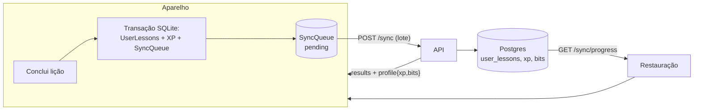

# Sincronização e progresso

O progresso (lições concluídas e conquistas) nasce no aparelho, offline, e vai para a
nuvem por uma fila. No caminho inverso, ao entrar numa conta o aparelho recebe tudo o
que a nuvem já tem.

## Ida: a fila offline-first

### Gravar localmente

`DatabaseClient.completeLesson(userId, lessonId, xpReward?)` e `unlockAchievement` gravam
o dado de domínio **e** o evento em `SyncQueue` na **mesma transação**
(`withTransactionSync`) — é essa atomicidade que impede progresso e pendência de
divergirem. No código de tela, use `SyncService.recordLessonCompletion` /
`recordAchievementUnlock`, que gravam e já disparam o envio (nunca o `DatabaseClient`
direto, ou o gatilho de sync se perde).

Só a **primeira** conclusão de uma lição rende XP: se ela já está em `UserLessons`, não
grava nada e devolve `firstTime: false`.

### Enviar

`SyncService.flushQueue()`:

1. Resolve o usuário atual (`getCachedProfile`) e lê **apenas os eventos `pending` dele** —
   pendências de outra conta no mesmo aparelho ficam intocadas.
2. Marca como `syncing`, envia o lote em `POST /sync` e atualiza cada evento para
   `synced` ou `failed` conforme o `results` da resposta.
3. Falha de rede ou de transporte devolve tudo para `pending` (nunca marca `failed`).
4. Um *lock* em memória (`isFlushing`) evita envios concorrentes.
5. No início de cada flush, eventos presos em `syncing` (app encerrado com envio em voo)
   voltam para `pending`.

**Gatilhos**: boot e transição offline→online (`useNetworkSync`), logo após o login, e a
cada conclusão de lição ou conquista.

### O que o servidor faz com cada evento

`POST /sync` recebe até 100 eventos e aplica **cada um independentemente** (um inválido
não aborta o lote). A resposta é sempre `200`:

| Evento | Efeito | Resultado |
|---|---|---|
| `lesson_completed { lessonId }` | Insere em `user_lessons` e, na mesma transação, soma o XP da lição e os Bits dos níveis cruzados | `applied` · `duplicate` (já existia) · `error` |
| `achievement_unlocked { achievementId }` | Insere em `user_achievements` | idem |

- **Idempotência por constraint**: `P2002` (duplicado) vira `duplicate`; `P2003` (FK
  inexistente — lição removida, conquista sem linha) vira `error`. Não há tabela de log
  de eventos.
- **XP serializado**: o `UPDATE` do XP devolve o valor novo, travando a linha até o
  commit; o "antes" é `novo − recompensa`. Assim dois eventos do mesmo lote (que rodam
  em paralelo) nunca pagam o mesmo cruzamento de nível duas vezes.
- **`lesson_locked`**: lição do baú **não revelada** é recusada (`error`); nada de XP, e o
  resto do lote segue. O evento fica `failed` no app (terminal, sem retry).
- O servidor **não confere `min_level`** de aulas de aprofundamento (ver
  [Limitações](../roadmap.md)).
- Um evento `failed` é terminal e **não impede** o app de adotar o valor do servidor.

### Autocorreção: o servidor é a autoridade

A resposta traz `profile: { xp, bits }`. Quando, **depois da resposta**, o usuário não
tem mais eventos `pending`/`syncing`, o app adota esses valores (SQLite e `UserStore`).
Com a fila vazia o app ainda manda `{ events: [] }` (timeout próprio de 8 s) só para
receber o `profile` — é isso que corrige, no boot, o XP de quem reinstalou ou jogou em
outro aparelho.

A checagem vem *depois* da resposta porque uma lição concluída durante a requisição
entrou na fila e o servidor ainda não a conhece; a adoção fica fora do `try` do envio
para uma falha nela nunca devolver para `pending` eventos já `synced`.

## Volta: restaurar o progresso

Sem a volta, um aparelho novo mostraria o XP certo (vem no login) e **nenhuma lição
marcada nem emblema**.

`GET /sync/progress` devolve todas as lições concluídas (`{ lessonId, completedAt }`,
inclusive de aprofundamento e do baú) e as conquistas (`{ achievementId, unlockedAt }`),
sempre do dono do token.

`ProgressService.restoreProgress()`:

- busca com repetição automática (5 s, depois 10 s);
- grava no SQLite a **união** do servidor com o aparelho — nunca apaga nada, e o que foi
  feito offline e ainda está na fila continua esperando;
- **não enfileira eventos** (o servidor já conhece tudo; não passa por
  `completeLesson`/`unlockAchievement`, que pagam XP e gravam a fila);
- depois de aplicar algo novo: recarrega as conquistas, incrementa `ProgressStore.revision`
  (faz a lista de lições reler o SQLite) e atualiza o estado da loja (a janela de Dobro de
  XP também nasce vazia num aparelho novo).

**Quando roda** (`useProgressSync`): quando a pessoa entra numa conta (login ou abrir o
app já logado), ao recuperar a conexão e ao voltar do segundo plano depois de ~10 min
(a conta pode ter sido usada em outro aparelho). Uma execução por vez; nunca lança; sem
rede, tenta na próxima ocasião; descarta o resultado se a conta mudou no meio.

### Testar um "aparelho novo"

No emulador: `adb shell pm clear host.exp.exponent` apaga todos os dados do Expo Go
(login, SQLite, cache). Reabra o app, entre na conta de teste e confira a lista de lições
e as Conquistas. Isso também apaga o histórico de servidores do Expo Go.

## Regra para dados novos

> Todo dado que o app escreve na nuvem precisa de um caminho de volta.

Ao criar um novo tipo de evento sincronizável: uma função `applyXxx` dedicada no
servidor, idempotência por constraint única no schema, **e** a leitura dele em
`GET /sync/progress` (ou rota equivalente) com restauração no login.

## Limitações assumidas

- Refazer uma lição já concluída num aparelho **sem o histórico** (antes da restauração
  terminar) mostra "+10 XP" na tela de conclusão por um instante; o valor volta ao certo
  quando a sincronização termina.
- Um evento malformado bloqueia o lote inteiro (o `/sync` valida o lote todo e devolve
  400). A causa conhecida (id não UUID) foi eliminada; se voltar, o caminho é marcar como
  `failed` em vez de `pending` nesse caso.
- A restauração só soma: um evento recusado pelo servidor (`lesson_locked`) segue marcado
  só neste aparelho.
