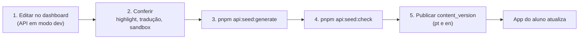

# Autoria de conteúdo

Do dashboard ao aluno: como editar o currículo, manter o `seed.ts` em dia e fazer a
mudança chegar ao app. Para o formato de cada atividade, veja
[Tipos de atividade](../referencia/tipos-de-atividade.md).

## O ciclo completo

1. **Edite no dashboard** (`pnpm api:dev` + `pnpm dash:dev`). Escreve direto no banco.
2. **Confira antes de seguir**:
   - o selo "sem pt"/"sem en" em cada entidade;
   - os termos de `highlight` com a contagem de ocorrências (uma palavra curta ou comum
     destaca **todas** as ocorrências);
   - os botões de teste dos exercícios de código.
3. **Atualize o seed** na mesma tarefa: `pnpm api:seed:generate`.
4. **Confirme** com `pnpm api:seed:check` (deve sair sem divergência).
5. **Publique uma `content_version`** em cada idioma editado. Sem isso, quem já abriu o
   app continua com o catálogo antigo em cache.

## Por que manter o `seed.ts` em dia

O conteúdo nasce e é editado **direto no banco**. O `seed.ts` não acompanha sozinho, e a
diferença é invisível: tudo continua funcionando, porque ninguém reseeda um banco que já
tem dados. O preço aparece muito depois — um banco novo nasce com o currículo antigo.

| Comando | O que faz |
|---|---|
| `pnpm api:seed` | Cria idiomas, áreas, módulos, lições, atividades, conquistas e a versão `0.0.0` de conteúdo. Idempotente por *guards* escopados (por módulo, nunca contagem global). |
| `pnpm api:seed:check` | Compara os arrays do `seed.ts` com o banco: lições faltando, ordem, nome em cada idioma, número de atividades e `content`. **Não escreve nada**; sai com código 1 se divergir. |
| `pnpm api:seed:generate` | Reescreve **só a declaração** de cada array `*_LESSONS` do `seed.ts` a partir do banco. |

Detalhes que importam:

- A correspondência entre seed e banco é **pelo nome em português, nunca pela posição**
  (uma lição inserida no meio não pode parecer divergência em todas as seguintes).
- O `content` é comparado com as chaves ordenadas (o JSONB não preserva a ordem).
- Os arrays são **exportados** e o `main()` fica atrás de uma checagem de execução direta;
  sem essa guarda, importar o seeder para comparar **semearia o banco**.
- Ao criar um array de lições novo: exporte-o e acrescente-o a `ALVOS` em
  `checkSeedDrift.ts`, senão aquele módulo deixa de ser verificado em silêncio.
- O gerador localiza cada array pelo Compiler API do TypeScript (não contando colchetes) e
  embute o código direto no array. Depois de rodar, as constantes antigas que só ele usava
  ficam órfãs; o `tsconfig` da API não cobre `prisma/`, então `tsc` não acusa — rode
  `npx tsc --noEmit` apontando para o arquivo ou confira à mão.
- O seeder dos módulos Intermediário/Avançado usa um seeder parametrizado
  (`seedModuleLessons`); o guard é por `module_id`. Prefira um array `ModuleLessonsSeed[]` a
  copiar uma função por área.

## Princípios do currículo

- **Cada área tem 4 módulos**; a ordem por `index` *é* a progressão (não há coluna de
  dificuldade).
- **Módulo 4 é "Além de"**: React (HTML), Tailwind (CSS) e Node/Express (JavaScript) são uma
  introdução, não um curso. **Não leve Node/Express para o Avançado** de nenhuma área.
- **Prática**: mais no começo, menos no fim, com **um sorteio por conceito central**
  (bancos de ~3 perguntas, ~1 verdadeiro/falso por banco). Tipos complexos (playground,
  desafio) aparecem **pouco no começo e mais no fim** do módulo e nos módulos avançados.
- A pergunta só pode cobrar o que a teoria **da própria lição** ensinou.
- **Nada é usado antes de ser apresentado.** Um termo, uma tag, uma propriedade ou uma
  sintaxe só pode aparecer num exemplo ou numa pergunta se já foi explicado em lição anterior
  *na ordem atual*. A exceção é um aviso curto ("você vai ver isso em breve"), e só para o
  que não é cobrado na prática. Mudou a ordem das lições? Releia as frases de ponte ("na
  próxima lição…", "daqui a pouco…") de quem foi movido.
- **Cada pergunta tem uma única leitura e uma única resposta certa** (ou todas as respostas
  válidas aceitas, como `send` e `end` numa lacuna de Express). Antes de fechar um exercício,
  procure uma alternativa errada que também funcione, o enunciado que entrega a resposta e o
  valor cobrado em formato que o aluno não saberia adivinhar.
- O que a revisão do 1.0.0 repetiu e deve ser evitado em conteúdo novo: usar `if`, arrays ou
  `class` antes das lições que os ensinam; cobrar `fr`, `space-between`, `px`, hexadecimal,
  `:root` ou `constructor` sem tê-los explicado; mostrar `` e dizer que "não tem
  tag de fechamento"; exemplos de React/Tailwind que dependem de JavaScript não ensinado.
- Termos técnicos (HTML, CSS, JavaScript) não se traduzem; `areas.name` não tem tradução.
- Um módulo tem `name` genérico ("Módulo N") e `subtitle` descritivo ("Além do
  JavaScript"). Nunca sobrescreva `name` com o descritivo.

## Regras de autoria

### Teoria

- Cada tela tem **introdução**, **explicação** (opcional), **código** e **fechamento**
  (opcional). Os títulos são digitados pelo autor (o dashboard recusa título vazio).
- **A primeira teoria de cada lição fala com a voz do Cody** (frase curta, ~14 palavras, e a
  definição vai na explicação); as demais usam a persona neutra. O backend recusa (422) a
  escrita que deixaria a primeira teoria neutra.
- Texto com um exemplo de código visível usa uma constante por idioma (`_PT`/`_EN`) quando o
  código contém texto legível; só compartilha a constante quando é feito só de termos
  técnicos idênticos.
- **`onlyCode: true`** desliga a aba "Web". Ligá-la é decisão de conteúdo, tela a tela: um
  JavaScript sem efeito visível nem `console.log` renderiza uma prévia vazia, o que ensina
  errado. Não ligue em JSX, TypeScript, `localStorage`/`fetch` ou código de Node.
- **Terminal**: lições de JavaScript puro rodam no terminal. Se o código só declara e
  atribui, ele precisa de um `console.log` final; se usa API que não existe na sandbox, use
  `noTerminal: true` ou um `terminalCode` simulado. Não marque como elegível uma lição que
  loga de dentro de um `setTimeout` (a captura é única, logo após o script síncrono).
- **TypeScript** nunca executa; o `terminalCode` é JavaScript já transpilado
  (`api/prisma/generateTerminalCode.ts` sugere um candidato para revisão humana — nunca
  escreve). Nunca embarque um transpilador no app para isso.
- Cuidado com `highlight`: o termo vira expressão regular **sem escape**.

### Prática

- **Máximo de 30 caracteres por linha** de código, em todo tipo.
- `option`: grave a correta sempre na posição 1 (o app embaralha). Verdadeiro/falso =
  `["Verdadeiro", "Falso"]` com `fixedOrder: true`. "Qual a saída?" só depois de **executar
  o trecho**.
- `reorder`: o enunciado cita cada valor e a ordem; só trechos com uma ordem válida.
- `code_blank`: duas respostas intercambiáveis ⇒ uma lacuna só.
- `fill_blank`: só letras, números, hífen e sublinhado; `ignoreCase` para HTML/CSS.
- Exercícios de código: **teste todas as combinações** (playground) e **variantes erradas**
  (desafio) num harness antes de gravar; limpe na correção tudo que ela alterar na página.

### Conferir o que se afirma

Toda afirmação técnica foi conferida antes de gravar: o JavaScript executado (Node `vm`,
inclusive cada distrator), o comportamento de HTML/CSS no Chromium e o `content` validado
contra os schemas zod do dashboard. Faça o mesmo — o conteúdo é o produto.

## Aulas especiais

- **Aprofundamento**: no formulário da lição, o interruptor **Aula de aprofundamento**
  (nível mínimo de 2 a 50 e XP de 1 a 100; sugestão de 30). O formulário mostra o que está
  gravado, sem inventar valores, e só envia o que o autor mexeu.
- **Aula do baú**: o interruptor **Aula do baú** (sugestão de 50 XP), mutuamente exclusivo
  com o anterior. Criar uma aula do baú **não a entrega a ninguém** — só o sorteio a revela.
- Criar qualquer uma das duas **não publica** `content_version`. **Atenção à ordem**: não
  publique nenhuma `content_version` (nem a de uma correção sem relação) enquanto a versão
  do app que entende esses campos não estiver com os alunos; uma instalação nova de um app
  antigo as receberia como lições obrigatórias da trilha.

## Scripts avulsos e backups

Mudanças em massa (migração de formato, correção de texto em lote) são feitas por **scripts
descartáveis** que:

1. têm *dry-run* por padrão e relatam o que mudaria;
2. só gravam com `--apply`, **depois de salvar um backup** do `content` original em
   `api/prisma/backups/` (ignorado pelo git);
3. são idempotentes e reversíveis a partir do backup.

Referência: `prisma/migrateTheoryV2.ts` (`pnpm --filter codap-api theory:migrate`,
`--apply`, `--revert <arquivo>`). Depois de aplicar: `seed:generate`, `seed:check` e
publicar `content_version`.

## Revisão do currículo (como foi feita a 1.0.0)

Antes de declarar o currículo estável, ele passou por duas leituras independentes, cada uma
por área: um **especialista web** (rigor técnico: cada afirmação, cada resposta marcada,
cada exercício executado quando possível) e um **leigo iniciante** (lê na ordem do app,
mantém um "caderno do aluno" do que já foi apresentado e aponta uso antes da apresentação,
perguntas que cobram o que não foi ensinado e lições sem impacto). As duas listas de
correção foram cruzadas: o fato técnico vale o do especialista; a clareza do texto, a do
leigo. Depois disso, a **ordem das lições** foi ajustada, as correções foram aplicadas em
português e inglês e as lacunas maiores ganharam telas de teoria novas. O método vale para
qualquer revisão grande: analisar em paralelo, **aplicar de forma centralizada** (para
duas revisões não editarem o mesmo trecho), validar tudo nos schemas do dashboard, regenerar
o `seed.ts` e só então publicar a `content_version`.

## Exportar para revisão

O dashboard exporta qualquer recorte (área, módulo ou lição) em Markdown ou PDF. Serve
para revisão por um professor — o currículo deve passar por validação pedagógica — ou por
uma IA. Os dois formatos partem do mesmo modelo, então nunca divergem.
