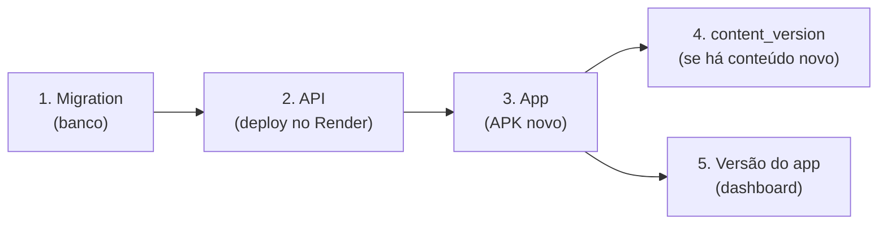

# Publicação

Como levar uma mudança ao ar: API, banco, conteúdo e o aplicativo (APK). Não há CI/CD
automatizado; o processo abaixo é manual.

## Ordem

Sempre que a mudança toca mais de uma peça:



Por que essa ordem:

- Uma API antiga **não conhece colunas novas** (ex.: `is_chest`, `app_version.locale_id`); a
  migration e o código novo da API precisam ir juntos.
- Um app antigo **não conhece conteúdo novo** (aulas opcionais, teoria no modelo novo);
  conteúdo só deve ser publicado depois que o app novo estiver com os alunos.
- O renome de uma coluna (`dependabots` → `bits`) quebra uma API antiga: migration e API juntas.

## 1. Banco (migration)

```bash
cd api
npx prisma migrate deploy
npx prisma generate
```

Nunca edite uma migration já aplicada. Em ambiente sem TTY, veja
[Modelo de dados](../modelo-de-dados.md#migrations). Lembre que **desenvolvimento e
produção compartilham o mesmo banco**: uma migration aplicada já vale para a API publicada.

## 2. API (Render)

- A API é um serviço Web no Render. Os comandos de build e de start e o diretório raiz
  ficam configurados no painel do Render (não há arquivo de infraestrutura no repositório).
  Em produção ela roda com `NODE_ENV=production` — é o que `pnpm start` faz (build +
  `fastify start`) —, e é isso que desliga o Swagger e as rotas de escrita.
- Variáveis de ambiente no painel do Render: `DATABASE_URL`, `JWT_ACCESS_SECRET`,
  `RESEND_API_KEY`, `MAIL_FROM` e **`PUBLIC_URL`** (a URL pública da API, sem barra no
  final — sem ela os e-mails não são montados e as rotas autenticadas de conta respondem 503).
- Confirme: `GET https://codap.onrender.com/` → `{"root":true}`.
- O plano gratuito dorme; o monitor externo a cada 5 min em `GET /` mantém a API acordada
  na maior parte do tempo. Ver [Servidor lento](../fluxos/servidor-lento-e-nova-versao.md).

## 3. Aplicativo (APK pelo EAS)

1. **Aumente a versão** em `app/app.json` (`"version"`), seguindo semver. Esse número é o
   que o app compara com a `app_version` publicada.
2. Garanta que `app/eas.json` aponta para a API publicada (`EXPO_PUBLIC_API_URL` nos perfis
   `preview`, `preview2`, `preview4`, `production`) — **o EAS não lê o `.env`**.
3. Gere o build (perfil `preview` produz um **APK**):

   ```bash
   cd app
   eas build --platform android --profile preview
   ```

4. Teste o APK num aparelho real: login, uma lição, loja, troca de idioma e, se mexeu em
   sync, um "aparelho novo".
5. Hospede o APK na **página de download** (`https://codap.gabrielsimoesdeveloper.com.br`).

> Não há eject: o EAS gera o código nativo a partir do `app.json` e dos plugins. Splash,
> ícone, notificações e a barra de navegação só têm efeito em **build nativo** — no Expo
> Go quem aparece é a tela do próprio Expo Go.

### Splash e ícones

A splash é fundo preto só com a logo (`icon.png`, `resizeMode: contain`, 200 dp). O ícone
do app é `assets/app-icon.png`, **opaco e sem margem** (1024×1024). O `icon.png` (com
margem transparente) continua servindo ao splash, ao primeiro plano do ícone adaptativo e ao
logo do login.

## 4. Conteúdo

Veja [Autoria de conteúdo](autoria-de-conteudo.md): `seed:generate` → `seed:check` →
publicar `content_version` em cada idioma (pelo dashboard, com a API em modo dev).

## 5. Avisar os alunos de um app novo

**Só depois** de o APK estar disponível na página de download:

1. `pnpm api:dev` e `pnpm dash:dev`.
2. No dashboard, botão **"Versão do app"**.
3. Informe a **mesma versão do `app.json`** do build distribuído.
4. Escreva o changelog **para o aluno**, nos dois idiomas (ambos obrigatórios) — o texto é
   exatamente o que aparece no aviso e no histórico em Configurações.
5. Marque **"Atualização importante"** só para segurança, idioma novo ou bug sério (reaparece
   a cada abertura do app até atualizar). O padrão é desligado: recomendada, uma vez por versão.

Publicar uma versão que ainda não tem build para baixar avisa as pessoas de algo que elas
não conseguem instalar. Nenhum aviso bloqueia o uso do app.

## Checklist de uma release

- [ ] Migrations aplicadas e `prisma generate` rodado
- [ ] `pnpm api:test` verde (preferencialmente em série)
- [ ] `cd app && npx tsc --noEmit` sem erros
- [ ] `pnpm api:seed:check` sem divergência (se houve conteúdo)
- [ ] `version` do `app.json` incrementada
- [ ] API publicada e `GET /` respondendo
- [ ] APK gerado, testado e hospedado
- [ ] `content_version` publicada (se houve conteúdo), em pt e en
- [ ] Versão do app publicada no dashboard, em pt e en
- [ ] Documentação atualizada na mesma mudança
