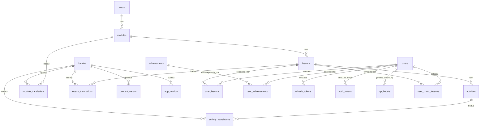

# Modelo de dados

O sistema tem **dois bancos**: o PostgreSQL do servidor (fonte da verdade, via
Prisma) e o SQLite do aparelho (progresso offline). Este documento descreve os dois.

A definição canônica do banco do servidor é [`api/prisma/schema.prisma`](../api/prisma/schema.prisma).

## PostgreSQL (servidor)

### Visão geral



### Estrutura pedagógica

Hierarquia: **área → módulo → lição → atividade**. Cada nível tem `index` (posição
na ordem de exibição, começando em 0).

| Tabela | Colunas relevantes | Observações |
|---|---|---|
| `areas` | `name` | **Não é traduzida**: HTML, CSS e JavaScript são iguais em qualquer idioma. |
| `modules` | `area_id`, `index` | Texto em `module_translations`. |
| `lessons` | `module_id`, `index`, `min_level`, `xp_reward`, `is_chest` | `min_level` preenchido = aula de aprofundamento; `is_chest` = aula exclusiva do baú. |
| `activities` | `lesson_id`, `index`, `type` | `type` é `VarChar(25)` livre, sem enum. |
| `locales` | `locale` (`pt`, `en`), `name` | Idiomas disponíveis. |
| `module_translations` | PK `(module_id, locale_id)`, `name`, `subtitle` | `name` é o rótulo genérico ("Módulo 1"); `subtitle` é o nome descritivo ("Além do JavaScript"). |
| `lesson_translations` | PK `(lesson_id, locale_id)`, `name` | |
| `activity_translations` | PK `(activity_id, locale_id)`, `content` (JSONB) | O conteúdo da atividade, sem forma fixa — ver [Tipos de atividade](referencia/tipos-de-atividade.md). |

Decisões:

- **Não existe coluna de dificuldade.** "O módulo 2 é mais difícil que o 1" é uma
  convenção de conteúdo (a ordem por `index`), não um dado.
- **Não existe unique em `(pai, index)`.** A ordem só muda pelos endpoints de
  *reorder*, que renumeram `0..n-1` numa transação, para nunca haver duplicata.
- **Não há colunas de ícone/imagem.** Essas decorações vivem no app
  (`app/src/screens/classes/areaMetadata.ts`), atribuídas por **posição** no array
  retornado — os `id`s são autoincrement imprevisíveis e nunca devem ser fixados
  em código.
- **Remover cascateia o conteúdo mas nunca destrói progresso**: se alguma lição do
  subgrafo tem linhas em `user_lessons` (ou `user_chest_lessons`), o `DELETE`
  responde 409 e nada é apagado.

### Usuários e progresso

| Tabela | Colunas relevantes | Observações |
|---|---|---|
| `users` | `id` (UUID), `name`, `email` (único), `password` (bcrypt), `email_verified_at`, `welcome_sent_at`, `xp`, `bits`, `instant_hints`, `chest_misses`, `is_master` | `xp`/`bits` são `Int?` (normalizados para 0). `email_verified_at` nulo = não confirmado. `is_master` (padrão falso) liga a [conta mestra](fluxos/gamificacao.md#conta-mestra); só se altera por SQL. |
| `user_lessons` | `user_id`, `lesson_id`, `completed_at`; **unique** `(user_id, lesson_id)` | A constraint é o que torna o `/sync` idempotente. |
| `user_achievements` | `user_id`, `achievement_id`, `completed_at`; **unique** `(user_id, achievement_id)` | |
| `achievements` | `name`, `description` | **Ids fixos**: 1 = HTML, 2 = CSS, 3 = JavaScript, 4 = Tríade Web. Contrato com o app. |
| `xp_boosts` | `user_id`, `starts_at`, `ends_at` | Janelas de Dobro de XP compradas. |
| `user_chest_lessons` | `user_id`, `lesson_id`, `revealed_at`; **unique** `(user_id, lesson_id)` | A coleção do Baú Surpresa. |

### Autenticação

| Tabela | Colunas relevantes | Observações |
|---|---|---|
| `refresh_tokens` | `token_hash` (único, SHA-256), `family_id`, `remember_me`, `expires_at`, `revoked_at`, `replaced_by_id`, `device_info`, `created_by_ip` | Uma **família** liga toda a cadeia de rotações de uma sessão. |
| `auth_tokens` | `type` (`email_verification` \| `password_reset`), `token_hash` (único), `expires_at`, `used_at` | Uso único. `ON DELETE CASCADE` com o usuário. |

### Versionamento

| Tabela | Colunas relevantes | Observações |
|---|---|---|
| `content_version` | `locale_id`, `version`, `changelog`, `released_at` (data), `announce` | Publicada por idioma. `announce` falso = atualização silenciosa. |
| `app_version` | `locale_id`, `version`, `changelog`, `need_update`, `released_at` | Uma linha por **idioma e versão**. `need_update` = aviso enfático. |

Para as duas: a publicação "mais recente" é sempre a de **maior `id`**, nunca por
`released_at` (que é só uma data e empata no mesmo dia). `version` é `VarChar(20)`.

### Convenções

- Nomes de tabela e coluna no banco do servidor são `snake_case` (o Prisma os expõe
  assim). Os **DTOs** em `contracts.ts` usam `camelCase` — a regra é: `snake_case`
  só onde o tipo é derivado direto de uma linha do Prisma, `camelCase` no que é um
  formato só de TypeScript.
- O client gerado fica em `api/src/generated/prisma` (dentro de `src/` por causa do
  `rootDir` do `tsconfig`), **não é versionado** e usa `importFileExtension = "js"`
  — não remova essa opção do `generator`, senão o ESM quebra em runtime.

### Migrations

`api/prisma/migrations/` é versionado e é o histórico real do banco. **Nunca edite
uma migration já aplicada**; crie uma nova.

`prisma migrate dev` exige TTY. Em ambiente não interativo:

```bash
cd api
npx prisma migrate diff --from-config-datasource --to-schema ./prisma/schema.prisma --script
# salve o SQL em prisma/migrations/<timestamp>_<nome>/migration.sql
npx prisma migrate deploy
npx prisma generate
```

Ordem ao publicar uma mudança que toca banco e clientes: **migration → API → app**
(ver [Publicação](guias/publicacao.md)).

## SQLite (aparelho)

Arquivo `Users.db`, aberto **uma vez** por `DatabaseClient` e compartilhado
(`expo-sqlite` faz pooling por nome; **não existe `close()`**). O esquema é versionado
por `PRAGMA user_version` em `app/src/services/migrations.ts`; versão atual: **6**.

| Tabela | Colunas | Observações |
|---|---|---|
| `Users` | `remoteId` (PK, o UUID do servidor), `name`, `email`, `bits`, `xp`, `doubleXpEndsAt`, `lastProfileSyncAt` (+ colunas legadas `doubleXp`, `doubleTime`, nunca lidas) | Cache do perfil. XP e Bits são **estimativas** que o servidor corrige. |
| `UserLessons` | `id`, `userId` → `Users.remoteId`, `lessonId` | Lições concluídas. Sem unique: a inserção checa a existência. |
| `SyncQueue` | `id`, `userId`, `clientEventId` (UUID, único), `type`, `payload`, `occurredAt`, `status`, `attempts`, `lastError`, `createdAt`, `updatedAt` | Fila de envio. `status`: `pending` → `syncing` → `synced` \| `failed`. |
| `UserAchievements` | `id`, `userId`, `achievementId`, `unlockedAt`; unique `(userId, achievementId)` | |

Convenções:

- **Colunas em `camelCase`** (o SQLite local tem formato próprio, não espelha o
  Postgres); **tabelas em `PascalCase`**.
- Um aparelho pode ter **várias contas ao longo do tempo**, por isso as tabelas
  carregam `userId`: pendências de uma conta nunca são enviadas sob a sessão de outra.
- Mudança de esquema: novo `if (version < N)` em `migrations.ts`, **idempotente**
  (confira `PRAGMA table_info` antes de um `ALTER`). Uma migração que quebra trava o
  app offline.
- IDs de evento são `randomUUID()` (do `expo-crypto`) — o `/sync` exige `format: uuid`.

### Outros armazenamentos locais

| Chave / local | Conteúdo |
|---|---|
| `expo-secure-store` | `refreshToken`, `accessToken`, `accessTokenExpiresAt` |
| AsyncStorage `CachedProfile` | Só **quem** é a conta logada (o `remoteId`) |
| AsyncStorage `ContentVersions` | Por idioma: `syncedId`, `seenId` e as notas de aviso pendentes |
| AsyncStorage `AppVersionInfo` | Histórico de versões do app e a última vista |
| AsyncStorage `CurrentTheme` / `CurrentLanguage` / `CurrentFontSize` | Preferências |
| AsyncStorage `NotificationsEnabled` | `"true"`/`"false"`; ausente = ainda não decidiu |
| AsyncStorage (React Query persistido) | Catálogo de áreas e módulos, e a coleção do baú |
