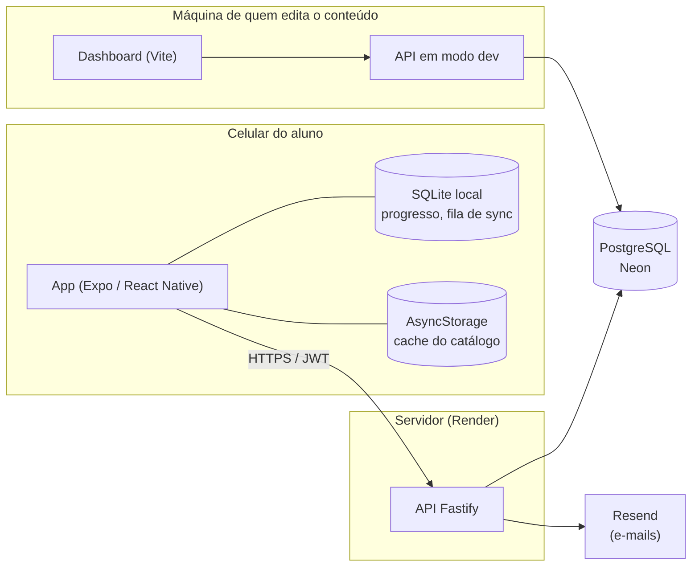
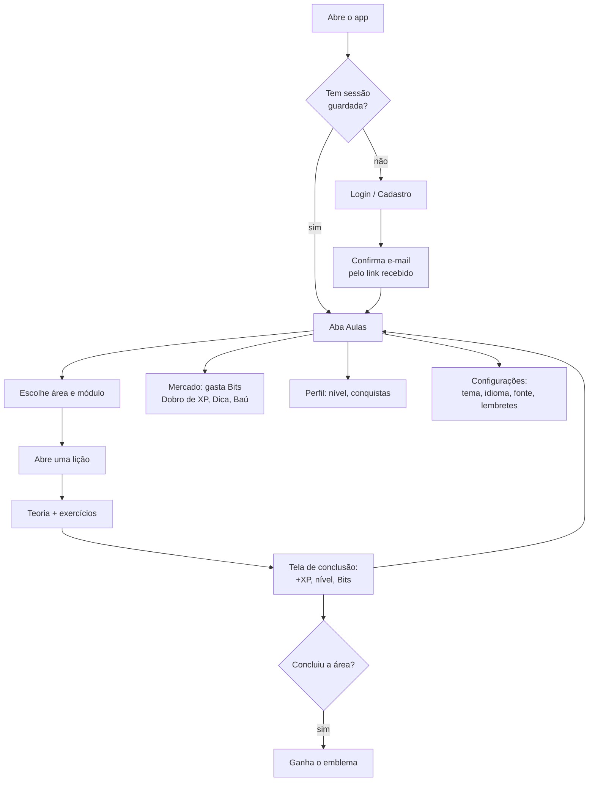

# Visão geral

## O que é o Codap

O Codap é um aplicativo de aprendizado **gamificado** de **HTML, CSS e JavaScript**
para celular. A pessoa estuda em lições curtas — texto, código para ler, exercícios
de escolha, de completar e de montar código — ganha XP, sobe de nível, junta Bits
(a moeda do app) e desbloqueia emblemas. O mascote é o **Cody**.

Pontos de produto que moldam o sistema inteiro:

- **Funciona sem internet.** Depois do primeiro carregamento, estudar, ganhar XP e
  subir de nível não dependem de rede; o que foi feito offline é enviado depois.
- **O currículo vive no servidor, não no app.** Corrigir ou acrescentar uma lição
  não exige publicar uma versão nova do aplicativo.
- **Nada na trilha principal fica trancado** por nível, moeda ou sorte. Nível e Bits
  dão acesso a conteúdo *opcional* e a conveniências.
- **Não está nas lojas.** O app é distribuído como APK pela página oficial
  (<https://codap.gabrielsimoesdeveloper.com.br>); por isso ele mesmo avisa quando há
  uma versão nova.
- **Dois idiomas** (português e inglês) em toda a interface e em todo o conteúdo.

## Os três pacotes

O repositório é um **monorepo** com workspace pnpm unificado:

| Pacote | Pasta | O que é | Tecnologias |
|---|---|---|---|
| **App** | `app/` | O aplicativo que o aluno usa | Expo SDK 57, React Native, TypeScript, SQLite, Zustand, React Query |
| **API** | `api/` | O servidor: contas, sincronização, loja e catálogo | Fastify 5, TypeScript, Prisma 7, PostgreSQL (Neon), JWT |
| **Dashboard** | `dashboard/` | Ferramenta **local** para editar o currículo | Vite, React, Tailwind v4, shadcn/ui, React Query |

O **dashboard não fala com a API de produção**: ele roda no computador de quem
edita, contra uma API local (`NODE_ENV=development`) ligada ao **mesmo banco**.
As rotas de escrita do catálogo só existem nesse modo — em produção elas nem são
registradas. O app, em produção, só lê.

## Como uma pessoa usa o app (visão de produto)

As quatro abas do app são **Aulas**, **Mercado**, **Perfil** e **Configurações**.

## Conteúdo pedagógico

O currículo tem **3 áreas** (HTML, CSS, JavaScript), cada uma com **4 módulos**:

| Módulo | Tema |
|---|---|
| 1 — Básico | Fundamentos da tecnologia |
| 2 — Intermediário | Layout, formulários, DOM, assíncrono… |
| 3 — Avançado | Semântica e acessibilidade, animações, closures, TypeScript… |
| 4 — "Além de" | Introdução ao React (HTML), Tailwind (CSS) e Node/Express (JavaScript) |

São cerca de **190 lições** na trilha principal (192 em outubro de 2026), cada uma com atividades de **teoria** e de
**prática** (ver [Tipos de atividade](referencia/tipos-de-atividade.md)). Há ainda
conteúdo opcional: **aulas de aprofundamento** (abrem por nível) e **aulas do baú**
(reveladas no Baú Surpresa).

## Glossário

| Termo | Significado |
|---|---|
| **Área** | Uma tecnologia ensinada: HTML, CSS ou JavaScript. |
| **Módulo** | Um bloco de lições de uma área (4 por área). |
| **Lição** | Uma unidade de estudo com várias atividades; concluir uma paga XP. |
| **Atividade** | Uma tela dentro da lição. O `type` define o componente (`theory`, `option`, `code_blank`…). |
| **Cody** | O mascote; fala na introdução da primeira teoria de cada lição. |
| **XP** | Pontos de progresso. Definem o **nível** e nunca são gastos. |
| **Nível** | De 1 a 50, derivado do XP. |
| **Bits** | A moeda do app; creditados ao subir de nível e gastos na loja. |
| **Conquista / emblema** | Um por área concluída, mais a *Tríade Web*. |
| **Aula de aprofundamento** | Lição opcional que abre a partir de um nível mínimo. |
| **Aula do baú** | Lição exclusiva, revelada no Baú Surpresa e guardada numa coleção. |
| **Desafio do módulo** | Lição "Testando seus conhecimentos" com um editor de código livre. |
| **Fila de sync** | Eventos de progresso feitos offline, aguardando envio ao servidor. |
| **`content_version`** | Versão do **conteúdo**; muda quando o currículo é republicado. |
| **`app_version`** | Versão do **aplicativo**; muda quando um novo APK é distribuído. |
| **Gate de desenvolvimento** | Rotas que só existem com `NODE_ENV=development`. |

## Quem fez

Autores listados no [README](../README.md#autores). Licença GPL-3.0 (arquivo
[LICENSE](../LICENSE)).
